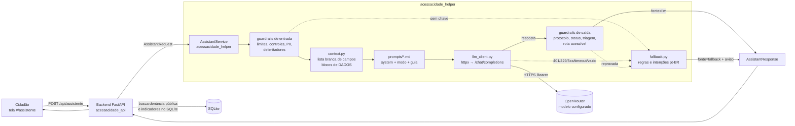

# Disciplina 01 — Generative AI for Engineering: AcessaCidade Helper

> **Atenção — requisitos formais a confirmar.** No PDF oficial da Global Solution 2026.2 a atividade
> desta disciplina aparece como **TBD** (nome, papel no MVP, conceito, objetivo, entregáveis e
> avaliação), com a orientação de falar diretamente com o professor **Reinaldo Augusto de Oliveira Ramos**.
> Este componente foi desenvolvido pelo escopo definido pela equipe (IA generativa resolvendo uma
> parte real do problema do MVP) e precisa ser **confirmado com o professor**. Veja
> `PENDENCIAS_E_ACOES_MANUAIS.txt`. [PREENCHER: requisitos confirmados com o professor e data]

## 1. Objetivo

O **AcessaCidade Helper** é o assistente de IA generativa do AcessaCidade, a plataforma em que
pessoas registram e acompanham denúncias de problemas de acessibilidade em calçadas e espaços
públicos (ODS 11). Ele resolve três dores reais do cidadão, em linguagem simples:

1. **Escrever uma boa descrição** do problema (modo `descricao`): organiza o texto da pessoa em
   *O quê / Onde / Tamanho aproximado / Impacto / Quem é afetado*, sugere tipo e impacto e pergunta o
   que faltar — **sem inventar fatos**.
2. **Entender o resultado da triagem automática da foto** (modo `explicar_resultado`): explica a
   classificação da visão computacional, a pontuação (que **não** é probabilidade) e a revisão humana.
3. **Tirar dúvidas e acompanhar a denúncia** (modo `geral`): como registrar, o que significa cada
   status, consulta por protocolo, privacidade/LGPD, ODS 11.

Princípios: **IA responsável** (não inventa protocolo, status ou resultado; nunca diz que uma rota é
acessível; a triagem não é avaliação oficial; o AcessaCidade não é serviço oficial do governo),
**resiliente** (sem chave ou com a API fora do ar, responde em *modo básico* por regras) e
**LGPD by design** (o nome do denunciante nunca chega ao modelo; dados pessoais óbvios são removidos).

## 2. Arquitetura



| Módulo | Responsabilidade |
|---|---|
| `src/acessacidade_helper/config.py` | Lê `OPENROUTER_API_KEY`, `OPENROUTER_MODEL`, `OPENROUTER_BASE_URL`, `ASSISTANT_TIMEOUT_SECONDS`, `ASSISTANT_PROMPTS_DIR`. A chave nunca aparece em `repr`/logs. |
| `prompts.py` | Carrega `prompts/*.md`, remove comentários `<!-- -->`, substitui marcadores `{{...}}` e falha se faltar algum. |
| `context.py` | Monta o contexto seguro: denúncia pública por **lista branca** (sem nome, sem coordenadas, sem URLs de imagens), indicadores, enumerações, significado dos status; coloca tudo em **blocos delimitados**. |
| `llm_client.py` | Cliente `httpx` para API compatível com OpenAI (`/chat/completions`), `temperature=0.2`, `max_tokens=500`, cabeçalhos `Authorization: Bearer` e `X-Title: AcessaCidade`; erros viram exceções tipadas. |
| `guardrails.py` | Limites (mensagem ≤ 1000, histórico ≤ 6 × 1000), remoção de controles e de PII, neutralização de delimitadores, verificação pós-resposta. |
| `fallback.py` | Modo básico por regras: registrar, status, triagem, descrição, protocolo, privacidade, ODS 11, prefeitura/prazo, rota, emergência, indicadores, fora de escopo. |
| `service.py` | `AssistantService` / `AssistantRequest` / `AssistantResponse` (interface da seção 6 do contrato). |
| `__main__.py` | CLI para testes manuais. |

Interface (contrato, seção 6):

```python
from acessacidade_helper import AssistantService, AssistantRequest, AssistantResponse, extract_protocol

svc = AssistantService.from_env()
svc.llm_enabled                      # True com chave + prompts carregados
resp = svc.answer(AssistantRequest(mensagem="O que significa aguardando revisão?"))
resp.resposta; resp.fonte            # "llm" | "fallback"
resp.modelo; resp.avisos; resp.denuncia_referenciada
extract_protocol("meu protocolo é AC-2026-000012")   # "AC-2026-000012"
```

## 3. Como configurar (OPENROUTER_API_KEY / OPENROUTER_MODEL)

1. Na raiz do repositório: `Copy-Item .env.example .env` (o `.env` não é versionado).
2. Preencha no `.env`:
   - `OPENROUTER_API_KEY=` com a chave criada na conta OpenRouter da equipe (nunca no código, nunca no Git);
   - `OPENROUTER_MODEL=openai/gpt-4o-mini` (padrão; pode trocar por outro modelo do catálogo OpenRouter);
   - `OPENROUTER_BASE_URL=https://openrouter.ai/api/v1` (padrão);
   - `ASSISTANT_TIMEOUT_SECONDS=20` (limitado entre 1 e 120 s).
3. Opcional: `ASSISTANT_PROMPTS_DIR` para testar outra pasta de prompts sem alterar o código.
4. Na nuvem (Azure Container Instances) a chave entra como **secure environment variable**, vinda de
   um **GitHub Secret** — passo a passo em `PENDENCIAS_E_ACOES_MANUAIS.txt`.

Sem chave, tudo funciona em **modo básico** (`fonte = "fallback"`, aviso *"Assistente em modo básico"*).

## 4. Como testar

```powershell
# na raiz do repositório
.\.venv\Scripts\python.exe -m pytest 01-Generative-AI-Engineering/tests

# CLI (sem backend). Sem chave => modo básico.
$env:PYTHONPATH = "01-Generative-AI-Engineering/src"
.\.venv\Scripts\python.exe -m acessacidade_helper "O que significa aguardando revisão?"
.\.venv\Scripts\python.exe -m acessacidade_helper "Qual o status?" --protocolo AC-2026-000999
.\.venv\Scripts\python.exe -m acessacidade_helper "explique" --modo explicar_resultado --denuncia-json 01-Generative-AI-Engineering/examples/entradas/denuncia_simulada_com_foto.json
.\.venv\Scripts\python.exe -m acessacidade_helper "buraco de 40 cm na Rua Exemplo, cadeirante não passa" --modo descricao --json

# Exemplos reproduzíveis
.\.venv\Scripts\python.exe 01-Generative-AI-Engineering/examples/gerar_exemplos_fallback.py   # saídas reais do modo básico
.\.venv\Scripts\python.exe 01-Generative-AI-Engineering/examples/gerar_exemplos_erros.py      # erros simulados (MockTransport)
.\.venv\Scripts\python.exe 01-Generative-AI-Engineering/examples/gerar_exemplos_llm.py        # SÓ com chave: respostas reais do LLM
```

Resultado registrado nesta entrega (execução local em 2026-11-15, Windows 11, Python 3.11.9):
`145 passed` — detalhes em `docs/PLANO_DE_TESTES_E_EVIDENCIAS.md`. Todos os testes usam
`httpx.MockTransport` (sem rede, sem chave real).

## 5. Integração com o produto

- **Backend:** `POST /api/assistente` (contrato, seção 4.9) cria o `AssistantService.from_env()` uma vez,
  busca a denúncia pelo protocolo (campo `protocolo` ou regex na mensagem), monta o `AssistantRequest`
  e devolve `resp.to_dict()`. `GET /health` informa `componentes.assistente = "llm" | "fallback"`
  com `svc.llm_enabled`. Métrica `acessacidade_assistente_respostas_total{fonte}`.
- **Frontend:** tela `#/assistente` (chat), com seletor de modo (`geral`, `descricao`,
  `explicar_resultado`), exibição da `fonte` e dos `avisos`. Atalhos a partir de `#/registrar`
  (ajuda na descrição) e `#/denuncia/{protocolo}` (explicar resultado).
- Detalhes, exemplos de código e checklist: `docs/INTEGRACAO.md`.

## 6. Custos estimados de uso (com premissas declaradas)

Medição real do tamanho do prompt montado pelo helper (caracteres, medido com o código desta entrega):

| Caso | Sistema (car.) | Dados + pergunta (car.) | Total (car.) |
|---|---|---|---|
| Pergunta geral ("como registrar") | 10.930 | 491 | 11.421 |
| Consulta com denúncia fornecida | 10.930 | 2.052 | 12.982 |
| Explicar resultado com denúncia | 11.501 | 2.062 | 13.563 |
| Modo descrição | 11.372 | 545 | 11.917 |

Premissas (estimativas, **não** medições de faturamento):
- 1 token ≈ 3,5 caracteres em português (premissa conservadora) ⇒ ~3.300 a ~3.900 tokens de entrada por pergunta;
- resposta média de 200 tokens (máximo configurado: 500);
- preço de referência do `openai/gpt-4o-mini`: US$ 0,15 por 1 milhão de tokens de entrada e US$ 0,60 por
  1 milhão de tokens de saída [PREENCHER: confirmar o preço vigente na página do modelo no site do OpenRouter na data da entrega];
- sem considerar descontos de cache de prompt.

| Cenário | Cálculo | Custo estimado |
|---|---|---|
| 1 pergunta (típica) | 3.900 × 0,15/10⁶ + 200 × 0,60/10⁶ | ≈ US$ 0,0007 |
| 1 pergunta (pior caso, 500 tokens de saída) | 3.900 × 0,15/10⁶ + 500 × 0,60/10⁶ | ≈ US$ 0,0009 |
| Rodar os 20 casos de teste (`gerar_exemplos_llm.py`) | 20 × 0,0007–0,0009 | ≈ US$ 0,014–0,018 |
| 1.000 perguntas/mês | 1.000 × 0,0007–0,0009 | ≈ US$ 0,70–0,90 |
| 10.000 perguntas/mês | 10.000 × 0,0007–0,0009 | ≈ US$ 7–9 |

O consumo real fica registrado nos arquivos gerados por `gerar_exemplos_llm.py` (tokens informados
pelo provedor) e no painel de atividade da conta OpenRouter. Recomenda-se **definir limite de gasto**
na chave. O `RATE_LIMIT_PER_MINUTE` do backend limita abuso. [PREENCHER: custo real observado após gerar os exemplos com LLM]

## 7. Limites e riscos (resumo)

- **Alucinação:** mitigada por regras no prompt, contexto fechado, `temperature=0.2` e verificação
  pós-resposta (heurística — não pega todos os casos). Respostas do LLM sempre levam o aviso
  "Resposta gerada por IA. Pode conter erros".
- **Prompt injection:** dados ficam em blocos delimitados e marcadores são neutralizados; não é defesa absoluta.
- **Privacidade:** com LLM ativo, a pergunta e os dados públicos da denúncia vão ao provedor externo
  (OpenRouter → provedor do modelo). Nome do denunciante nunca é enviado; PII óbvia é removida.
- **Dependência de terceiro e custo:** fallback automático; limite de gasto na conta.
- **Modo básico** reconhece intenções por palavras-chave: perguntas fora do padrão podem receber
  resposta genérica ou recusa.
- Análise completa: `docs/RISCOS_E_LIMITES.md`.

## 8. Estrutura da pasta

```text
01-Generative-AI-Engineering/
├── README.md
├── PENDENCIAS_E_ACOES_MANUAIS.txt
├── src/acessacidade_helper/        # pacote (importado pelo backend)
├── prompts/                        # system_prompt.md, modo_geral.md, modo_descricao.md,
│                                   # modo_explicar_resultado.md, guia_plataforma.md
├── examples/
│   ├── perguntas_teste.json        # 20 casos de teste
│   ├── entradas/                   # denúncias e indicadores SIMULADOS
│   ├── fallback/                   # saídas reais do modo básico (geradas)
│   ├── erros/                      # erros simulados com MockTransport (gerados)
│   ├── llm_real/LEIAME.md          # como gerar exemplos com o LLM real
│   └── gerar_exemplos_*.py
├── tests/test_helper_*.py          # 145 testes (pytest)
└── docs/
    ├── INTEGRACAO.md
    ├── ENGENHARIA_DE_PROMPTS.md
    ├── RISCOS_E_LIMITES.md
    ├── PLANO_DE_TESTES_E_EVIDENCIAS.md
    ├── RELATORIO_ENTREGA_GENAI.md  # fonte do PDF de entrega
    └── gerar_pdf_relatorio.py
```

## 9. Links da entrega

- Repositório: [PREENCHER: URL pública do repositório GitHub]
- MVP publicado (tela do assistente): [PREENCHER: URL pública do MVP]/#/assistente
- Vídeo de demonstração (se exigido pelo professor): [PREENCHER: link do vídeo]
- Integrantes: [PREENCHER: nomes e RMs dos integrantes]
