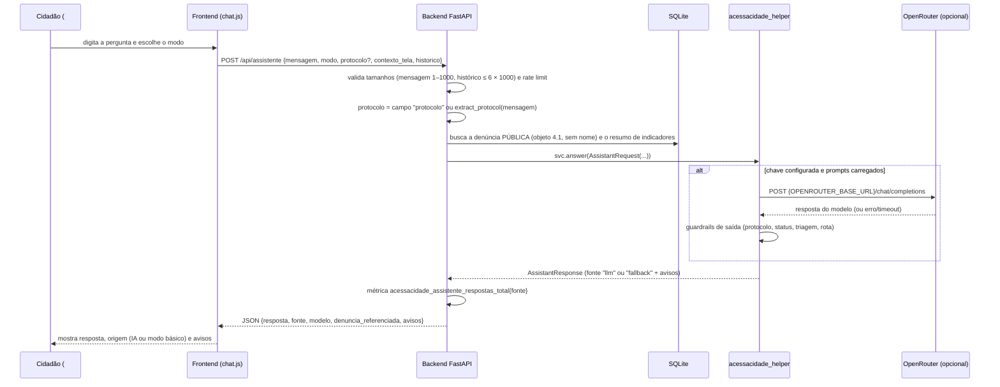

# Integração do AcessaCidade Helper com o produto

Documento de referência para quem integra o helper ao backend (`POST /api/assistente`) e à tela
`#/assistente`. A fonte normativa é `docs/CONTRATOS_DE_INTEGRACAO.md` (seções 4.9, 4.10, 6, 7, 10 e 11):
em caso de divergência, vale o contrato.

> **Estado na data desta documentação (2026-11-15):** o pacote `acessacidade_helper` está pronto e
> testado (145 testes). O frontend já chama `POST /api/assistente` (`app/frontend/js/api.js`,
> `js/views/assistente.js`, `js/components/chat.js`). **Atualização (15/11/2026, auditoria):** o backend
> (`app/backend/acessacidade_api/routes/assistente.py`) já implementa `POST /api/assistente` usando este
> pacote; a integração foi conferida localmente (testes da API, E2E 199/199 e o checklist da seção 6).
> Falta apenas a conferência na URL pública.

## 1. Fluxo ponta a ponta



## 2. Código de integração no backend (referência)

O helper **não acessa o banco**. O backend busca os dados e os entrega no `AssistantRequest`.

```python
from acessacidade_helper import AssistantService, AssistantRequest, extract_protocol

svc = AssistantService.from_env()   # criar UMA vez (startup) e reutilizar

def responder_assistente(corpo: dict) -> dict:
    protocolo = corpo.get("protocolo") or extract_protocol(corpo["mensagem"])
    denuncia = buscar_denuncia_publica(protocolo) if protocolo else None   # objeto 4.1 ou None
    req = AssistantRequest(
        mensagem=corpo["mensagem"],
        modo=corpo.get("modo", "geral"),
        historico=corpo.get("historico", [])[-6:],
        denuncia=denuncia,
        protocolo_solicitado=protocolo,          # mesmo que não exista no banco
        indicadores=resumo_indicadores(),        # opcional (GET /api/indicadores)
        opcoes=enumeracoes(),                    # opcional (seção 3 do contrato)
        contexto_tela=corpo.get("contexto_tela"),
    )
    resp = svc.answer(req)
    METRICA_ASSISTENTE.labels(fonte=resp.fonte).inc()
    return resp.to_dict()
```

Regras importantes para o backend:

| Regra | Motivo |
|---|---|
| Passe `protocolo_solicitado` mesmo quando a denúncia não for encontrada (`denuncia=None`) | O helper responde "Não encontrei a denúncia com o protocolo …" em vez de inventar |
| Entregue somente o objeto **público** da denúncia (seção 4.1) | O nome do denunciante nunca deve chegar ao helper nem ao LLM |
| Não registre em log a mensagem completa nem a chave | Seção 11 do contrato; o helper também não registra a chave |
| `GET /health` → `componentes.assistente = "llm" if svc.llm_enabled else "fallback"` | Seção 4.10 |
| Reutilize a instância de `AssistantService` | Evita reler prompts e recriar o cliente HTTP a cada pedido |

Defesas adicionais que o helper já aplica, independentemente do backend: lista branca de campos
da denúncia (`context.py`: sem nome, sem coordenadas, sem URLs de imagem), limite de tamanho,
remoção de caracteres de controle e de PII óbvia (e-mail, CPF, telefone), neutralização de
marcadores de bloco, verificação pós-resposta.

## 3. Requisição e resposta (contrato 4.9)

Requisição enviada pelo frontend:

```json
{"mensagem": "O que significa aguardando revisão?", "modo": "geral",
 "protocolo": "AC-2026-000012", "contexto_tela": "consulta",
 "historico": [{"papel": "usuario", "texto": "..."}]}
```

Resposta (`AssistantResponse.to_dict()`):

```json
{"resposta": "texto em português", "fonte": "llm", "modelo": "openai/gpt-4o-mini",
 "denuncia_referenciada": "AC-2026-000012", "avisos": ["Resposta gerada por IA. Pode conter erros: ..."]}
```

| Campo | Valores | Observação |
|---|---|---|
| `fonte` | `llm` \| `fallback` | `fallback` = modo básico por regras (sem chave, erro da API, timeout ou resposta reprovada pelos guardrails) |
| `modelo` | nome do modelo ou `null` | `null` no modo básico |
| `denuncia_referenciada` | protocolo ou `null` | só é preenchido quando a denúncia foi de fato fornecida pelo backend |
| `avisos` | lista de textos em pt-BR | o frontend deve exibir todos (ex.: "Assistente em modo básico…", aviso de triagem, aviso de dados simulados) |

## 4. Modos e pontos de entrada no frontend

| Modo | Para quê | Entrada típica no frontend |
|---|---|---|
| `geral` | dúvidas, status, consulta por protocolo, privacidade, ODS 11 | menu → `#/assistente` |
| `descricao` | organizar o texto do cidadão em O quê / Onde / Tamanho / Impacto / Quem é afetado | atalho a partir de `#/registrar` |
| `explicar_resultado` | explicar a triagem automática da foto de uma denúncia | `#/denuncia/{protocolo}` → `#/assistente?protocolo=...` (o frontend usa `explicar_resultado` quando há protocolo na URL) |

## 5. Configuração por ambiente

| Ambiente | Onde ficam as variáveis | Observação |
|---|---|---|
| Local | `.env` na raiz (copiado de `.env.example`, não versionado) | Sem `OPENROUTER_API_KEY` → modo básico |
| Docker / docker-compose | `env_file: .env` | Mesmas variáveis |
| Azure Container Instances | `OPENROUTER_API_KEY` como **secure environment variable**, vinda de **GitHub Secret** no pipeline | Responsabilidade do componente 06 (DevOps) |

Variáveis: `OPENROUTER_API_KEY`, `OPENROUTER_MODEL` (padrão `openai/gpt-4o-mini`),
`OPENROUTER_BASE_URL` (padrão `https://openrouter.ai/api/v1`; valores sem `https://` voltam ao padrão),
`ASSISTANT_TIMEOUT_SECONDS` (padrão 20, limitado a 1–120 s), `ASSISTANT_PROMPTS_DIR` (opcional).

## 6. Checklist de integração (para conferir antes da entrega)

Itens marcados com [x] foram conferidos **localmente** em 15/11/2026 (API rodando com o seed simulado,
sem chave de LLM); o modo `llm` e a URL pública continuam pendentes.

- [x] `app/backend` implementa `POST /api/assistente` conforme a seção 2 deste documento.
- [ ] `GET /health` mostra `"assistente": "llm"` com chave e `"fallback"` sem chave. — *local: `"fallback"` sem chave conferido; o valor `"llm"` depende da chave da equipe.*
- [x] `/metrics` expõe `acessacidade_assistente_respostas_total{fonte=...}` — *local: `{fonte="fallback"}` conferido.*
- [x] Na tela `#/assistente`, a origem (IA / modo básico) e os avisos aparecem para o cidadão (E2E 199/199).
- [x] Pergunta com protocolo inexistente (ex.: `AC-2026-999999`) → resposta "Não encontrei nenhuma denúncia com o protocolo…".
- [x] Pergunta com protocolo de uma denúncia simulada → resumo com o aviso "Esta denúncia é de demonstração: os dados são simulados.".
- [ ] Sem chave na nuvem, o chat continua respondendo (modo básico).
- [ ] A chave não aparece em logs do container, no repositório nem nos prints.
- [ ] [PREENCHER: data e responsável pela verificação na URL pública]
