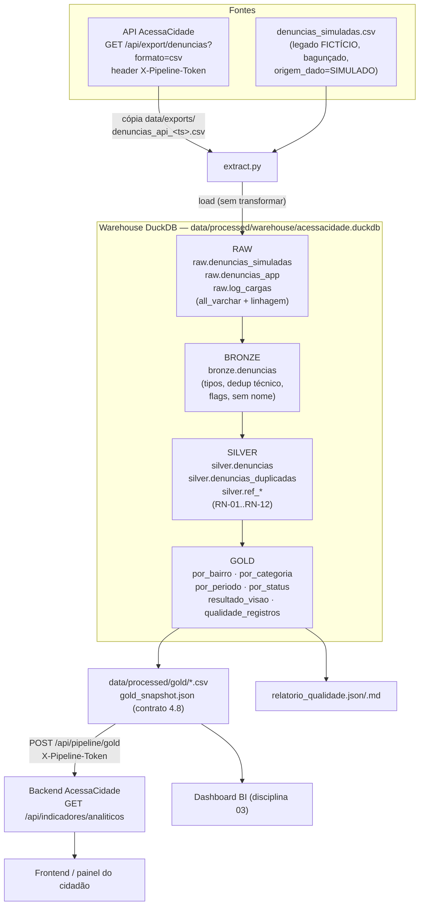
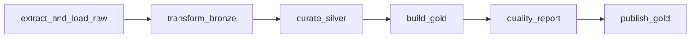
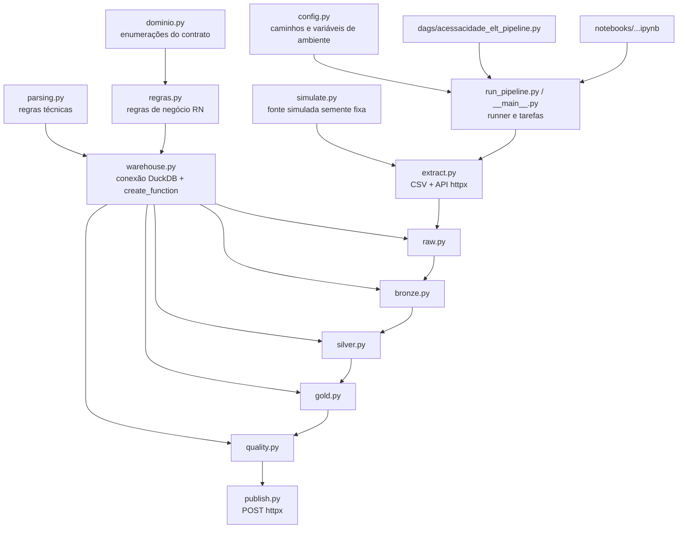

# Arquitetura do pipeline de dados — AcessaCidade

**Papel no MVP:** o componente "Dados" coleta as denúncias (fonte simulada + exportação da API do app), trata-as em
camadas e devolve indicadores prontos para o produto (`GET /api/indicadores/analiticos`) e para o dashboard de BI.

Padrão: **ELT em medalhão** (raw → bronze → silver → gold) dentro de um warehouse **DuckDB** embutido, orquestrado
pelo **Apache Airflow 2.10.5** (DAG TaskFlow) ou, sem Airflow, pelo runner local que executa as mesmas tarefas.

## 1. Visão geral (fontes → camadas → consumo)

## 2. DAG `acessacidade_elt_pipeline`

| Propriedade | Valor |
|---|---|
| Arquivo | `dags/acessacidade_elt_pipeline.py` (TaskFlow `@dag`/`@task`) |
| Agenda | `@daily`, `catchup=False`, `max_active_runs=1` (um escritor no DuckDB) |
| Tentativas | `retries=1`, `retry_delay=2 min` |
| Parâmetro | `usar_api` (padrão `true`; `{"usar_api": false}` roda só com a fonte simulada) |
| Tags | acessacidade, citizentech, ods11, elt, duckdb, gs2026 |
| XCom | cada tarefa devolve um dicionário pequeno de contagens (`estado`) |
| Falhas | `quality_report` reprovado ou publicação recusada → tarefa falha (retry); API/token ausentes → aviso e segue |

| Tarefa | Função do pacote | Faz |
|---|---|---|
| extract_and_load_raw | `run_pipeline.tarefa_extract_and_load_raw` | garante o CSV simulado; exporta da API (se configurada); carrega RAW |
| transform_bronze | `tarefa_transform_bronze` → `bronze.construir_bronze` | união, tipagem, dedup técnico, flags, minimização |
| curate_silver | `tarefa_curate_silver` → `silver.construir_silver` | regras RN-01..RN-12, dedup de negócio |
| build_gold | `tarefa_build_gold` → `gold.construir_gold`/`exportar_gold` | agregados, CSVs, snapshot |
| quality_report | `tarefa_quality_report` → `quality.gerar_relatorio` | contagens, verificações, relatório |
| publish_gold | `tarefa_publish_gold` → `publish.publicar_snapshot` | POST do snapshot na API |

O runner local (`python -m acessacidade_pipeline [--sem-api]`) chama as mesmas funções na mesma ordem
(`run_pipeline.ORDEM_TAREFAS`); o notebook também. **Uma só implementação.**

## 3. Componentes (pacote `src/acessacidade_pipeline`)

| Arquivo | Responsabilidade |
|---|---|
| `config.py` | `PipelineConfig`: `PIPELINE_DATA_DIR` (padrão `<raiz>/data`), `PIPELINE_WAREHOUSE_PATH`, `ACESSACIDADE_API_URL`, `PIPELINE_TOKEN`, `PIPELINE_HTTP_TIMEOUT` |
| `simulate.py` | gera `data/samples/denuncias_simuladas.csv` (semente 20261114) |
| `parsing.py` | `parse_data_multi`, `parse_coordenada`, `parse_decimal`, `parse_booleano`, `normalizar_texto`, `limpar_espacos` |
| `regras.py` | dicionário de bairros, mapeamentos de tipo/impacto/status/visão/origem |
| `warehouse.py` | abre o DuckDB, cria schemas e registra as funções Python no SQL (`create_function`) |
| `extract.py` | exportação da API com `X-Pipeline-Token`, validação das colunas do contrato 4.7, cópia em `data/exports/` |
| `raw.py`, `bronze.py`, `silver.py`, `gold.py` | camadas |
| `quality.py` | relatório e portão de qualidade |
| `publish.py` | publicação do snapshot |

## 4. Decisões de arquitetura

| Decisão | Motivo |
|---|---|
| **ELT** (carregar antes de transformar) | a RAW preserva a fonte para reprocessar quando uma regra mudar; transformação em SQL, auditável |
| **DuckDB embutido** | analítico, sem servidor — roda igual no Windows, no container do Airflow e no CI; volume do MVP é pequeno |
| **Full refresh** idempotente | as fontes são exportações completas; `CREATE OR REPLACE` garante o mesmo resultado a cada execução (testado) |
| **all_varchar na RAW** | nenhum valor ruim derruba a carga (schema-on-read) |
| **Funções Python no SQL** | regras testáveis com `pytest` e reutilizadas no SQL |
| **Minimização LGPD na Bronze** | o nome do denunciante (simulado) é descartado o mais cedo possível; a API já exporta sem nome |
| **Gold sem texto livre** | o snapshot vai para uma página pública; só agregados |
| **Integração por HTTP com token** | o pipeline não acessa o SQLite do app; usa a API (contratos 4.7 e 4.8) |
| **Airflow standalone em Docker** | Airflow 2.10.5 não roda no Windows nativo; Docker Desktop/WSL2 resolvem |

## 5. Caminho para escala (não implementado no MVP)

Com volume real, o mesmo desenho troca peças sem mudar as camadas: arquivos RAW em armazenamento de objetos
(Parquet particionado por data), DuckDB → warehouse gerenciado ou Spark, carga incremental por `atualizado_em`
em vez de full refresh, Airflow com CeleryExecutor/Kubernetes e PostgreSQL como metabanco.
