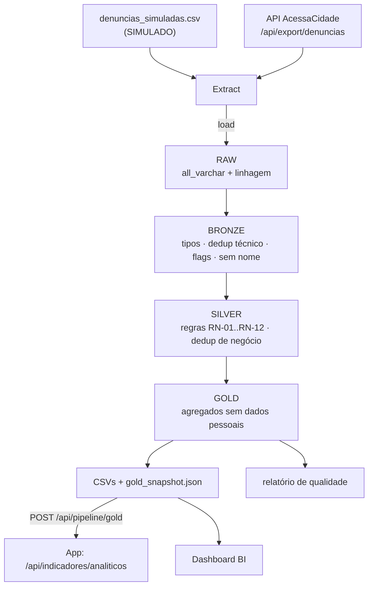
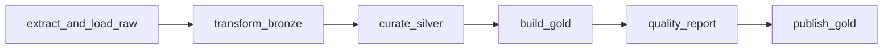

# AcessaCidade — Pipeline de Dados do MVP CitizenTech

**FIAP · Global Solution 2026.2 · CitizenTech (ODS 11 — Cidades e comunidades sustentáveis)**
**Disciplina:** Big Data Architecture & Data Integration — Prof.ª Ana Machado
**Atividade:** Pipeline de Dados do MVP CitizenTech (14 pontos: pipeline funcional 8 · arquitetura e documentação 6)

| | |
|---|---|
| Equipe | [PREENCHER: nome da equipe] |
| Integrantes (nome — RM) | [PREENCHER: integrante 1 — RM] · [PREENCHER: integrante 2 — RM] · [PREENCHER: integrante 3 — RM] · [PREENCHER: integrante 4 — RM] · [PREENCHER: integrante 5 — RM] |
| Repositório | [PREENCHER: URL do repositório] — pasta `02-Big-Data-Architecture/` |
| Vídeo do pipeline rodando | [PREENCHER: link do vídeo] |
| API publicada (se houver) | [PREENCHER: URL pública da API] |
| Data | [PREENCHER: data de entrega] |

## 1. Problema e papel do componente "Dados"

O AcessaCidade permite que pessoas com deficiência, cadeirantes, pessoas com mobilidade reduzida e idosos registrem
problemas de acessibilidade em calçadas e espaços públicos (buracos, calçadas danificadas, obstáculos), com triagem
da foto por visão computacional. O componente **Dados** coleta as denúncias, trata-as e entrega indicadores prontos
para o próprio produto (página de indicadores analíticos) e para o dashboard de BI.

**Fontes:**
1. `denuncias_simuladas.csv` — exportação de um sistema legado **fictício** da "Cidade Exemplo", **simulada** de forma
   justificada (o MVP ainda não tem histórico real): 271 linhas com grafias variadas, datas em 4+ formatos,
   coordenadas como texto, duplicatas exatas e quase-duplicatas, campos ausentes e um campo de nome (simulado) para
   demonstrar minimização LGPD. Gerada por script com semente fixa (`data/samples/LEIAME_denuncias_simuladas.md`).
2. Exportação da API do AcessaCidade (`GET /api/export/denuncias?formato=csv`, header `X-Pipeline-Token`), com as
   denúncias registradas no app (formulário web e robô RPA).

## 2. Arquitetura

ELT em medalhão (raw → bronze → silver → gold) num warehouse **DuckDB**, orquestrado por **Apache Airflow 2.10.5**
(DAG TaskFlow, agenda diária). A mesma lógica roda pelo runner local `python -m acessacidade_pipeline` e pelo notebook.

**DAG `acessacidade_elt_pipeline`** (`@daily`, `catchup=False`, `retries=1`):

| Camada | Tabelas | Responsabilidade |
|---|---|---|
| RAW | `raw.denuncias_simuladas`, `raw.denuncias_app`, `raw.log_cargas` | cópia fiel (texto), `_source_file`, `_ingested_at`, `_row_id`, `_batch_id` |
| BRONZE | `bronze.denuncias` | união das fontes, tipagem (`parse_data_multi`, `parse_coordenada`, `TRY_CAST`), dedup técnico `row_number() OVER (PARTITION BY todas as colunas)`, flags, nome não passa (LGPD) |
| SILVER | `silver.denuncias`, `silver.denuncias_duplicadas`, `silver.ref_*` | bairros padronizados, chaves do contrato (tipo, impacto, status, visão), dedup de negócio, `registro_valido` |
| GOLD | `gold.denuncias_por_bairro`, `_por_categoria`, `_por_periodo` (mensal/semanal), `_por_status`, `gold.resultado_visao`, `gold.qualidade_registros` | indicadores do produto/BI; snapshot JSON no contrato 4.8 |

Decisões principais: ELT preserva a fonte para reprocessamento; DuckDB embutido (sem servidor, igual em Windows,
container e CI); full refresh idempotente; regras em funções Python testadas e registradas no SQL; minimização de
dados pessoais na primeira transformação; integração com o app só por HTTP com token. Detalhes:
`docs/ARQUITETURA_PIPELINE.md` e `docs/REGRAS_DE_NEGOCIO.md`.

## 3. Resultado de uma execução real (fonte simulada, sem API)

Fonte: `docs/evidencias/execucao_local_runner.log` e `data/processed/relatorio_qualidade.md`.

| Métrica | Valor |
|---|---|
| Linhas RAW | 271 |
| Linhas BRONZE (após dedup técnico) | 260 (11 duplicatas exatas removidas) |
| Denúncias únicas SILVER (após dedup de negócio) | 250 (10 quase-duplicatas removidas) |
| Registros válidos (RN-12) | 211 (84,4%) |
| Datas inválidas / coordenadas inválidas / campos obrigatórios ausentes | 12 / 11 / 25 |
| Verificações de qualidade | todas OK — situação APROVADO |

Os números vêm de **dados simulados** e não representam uma cidade real.
Execução orquestrada no Airflow: [PREENCHER: prints da UI Graph/Grid/logs — ver `docs/EVIDENCIAS_NECESSARIAS.md`].

## 4. Como executar

- Runner local (Windows/Linux): `PYTHONPATH=02-Big-Data-Architecture/src python -m acessacidade_pipeline --sem-api`
- Airflow (Docker): `docker compose --env-file ../../.env -f docker-compose.airflow.yml up -d` em `02-Big-Data-Architecture/airflow`
- Testes: `python -m pytest 02-Big-Data-Architecture/tests`

Passo a passo completo: `docs/INSTRUCOES_EXECUCAO.md`.

## 5. Atendimento aos entregáveis e critérios do PDF

| Exigência do PDF | Onde está |
|---|---|
| Pipeline de ingestão, tratamento e modelagem com ETL/ELT e orquestração (Airflow) | `src/acessacidade_pipeline/`, `dags/acessacidade_elt_pipeline.py`, `airflow/docker-compose.airflow.yml` |
| Do dado bruto ao dado pronto para uso, alimentando de fato o MVP | Gold → `POST /api/pipeline/gold` → `GET /api/indicadores/analiticos` |
| Dados reais ou simulados de forma justificada | `data/samples/LEIAME_denuncias_simuladas.md` |
| Roda de ponta a ponta, orquestrado e repetível (não só notebook) | DAG + runner; idempotência testada |
| Repositório com scripts, notebooks ou DAGs e instruções de execução | pasta `02-Big-Data-Architecture/` + `docs/INSTRUCOES_EXECUCAO.md` |
| Diagrama de arquitetura e dicionário de dados das tabelas entregues | seção 2 e Anexo A deste documento |
| Prints ou vídeo do pipeline rodando (DAG no Airflow, logs, dados carregados) | [PREENCHER: prints/vídeo] |
| Pontuação: pipeline funcional 8 · arquitetura e documentação 6 | critérios detalhados no README da disciplina: [PREENCHER: conferir critérios publicados pela professora] |

## Anexo A — Dicionário de dados

(Gerado a partir de `docs/DICIONARIO_DE_DADOS.md` — ver a seguir.)
