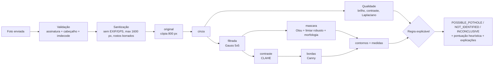
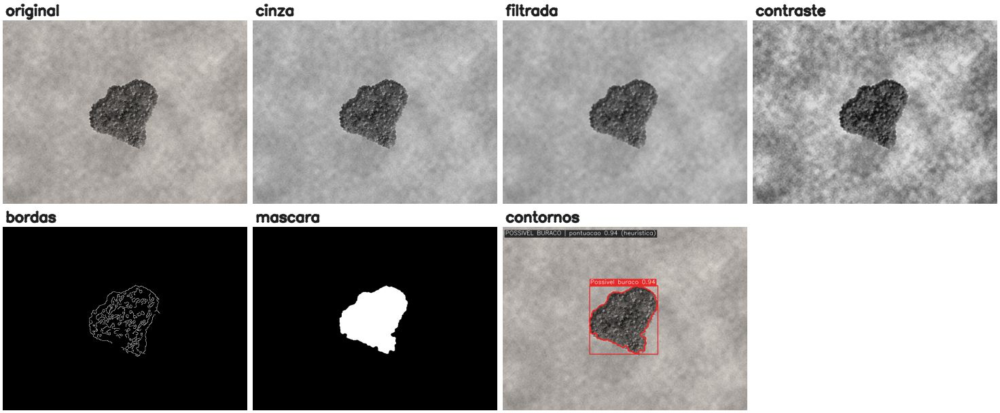
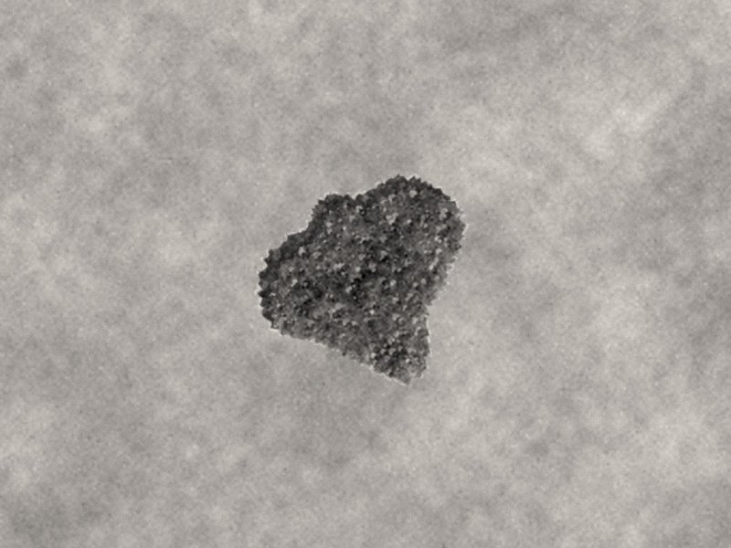
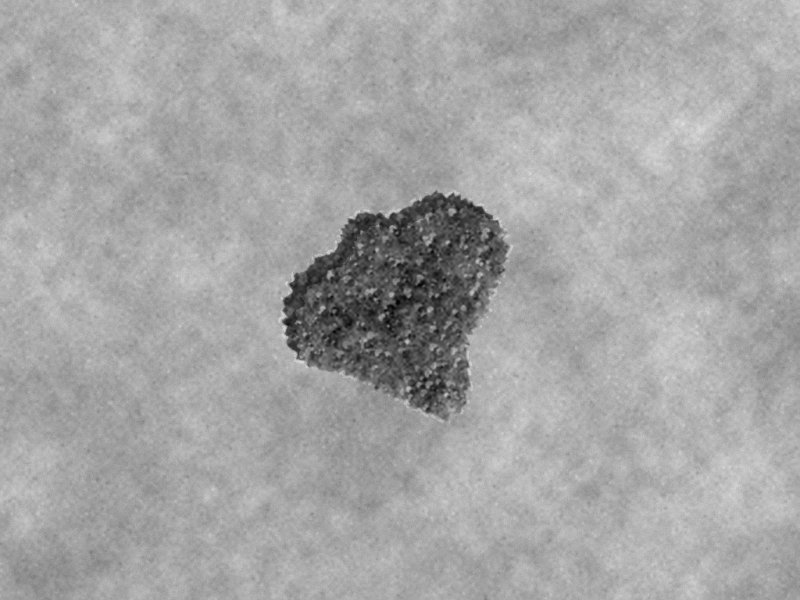
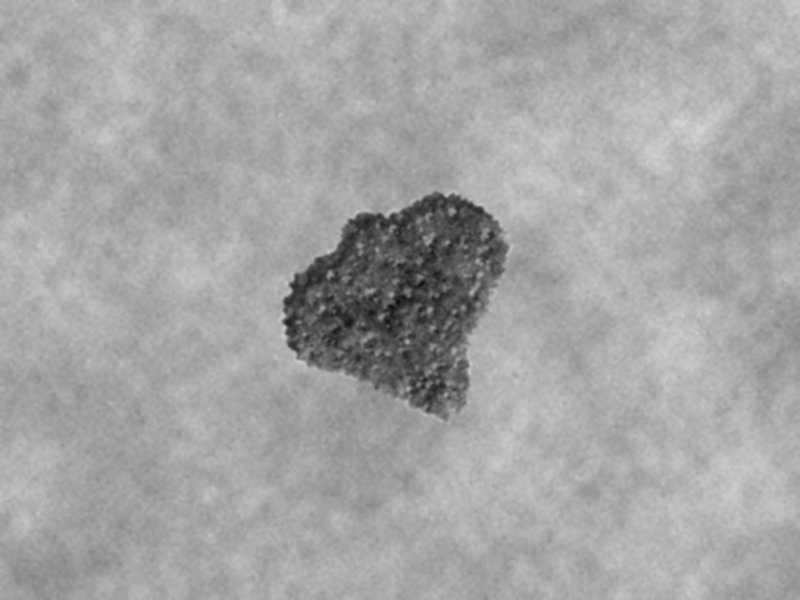
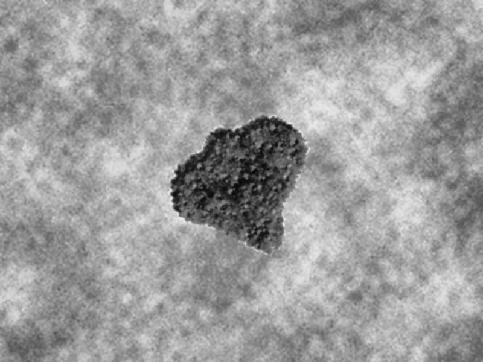
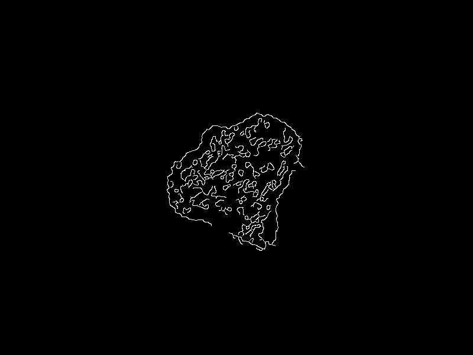
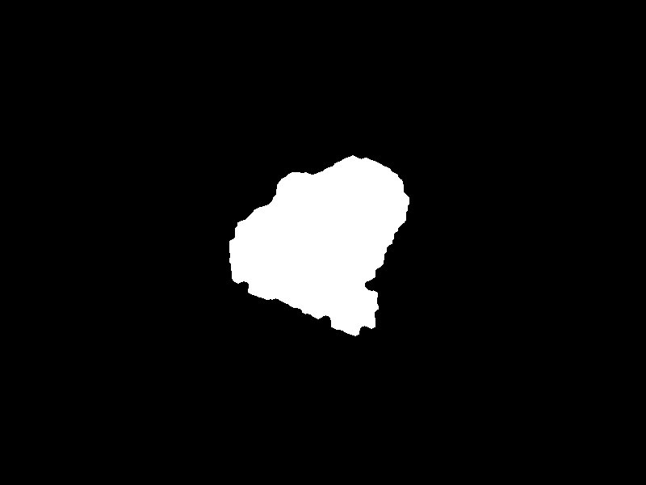
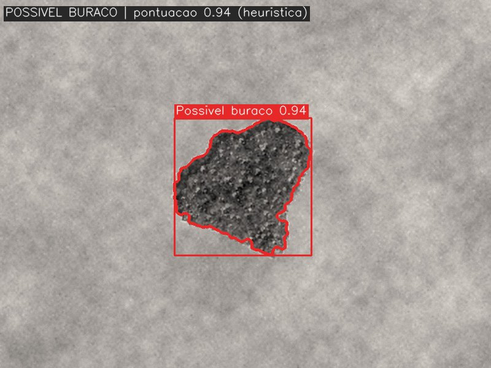

# Documentação técnica — transformações de imagem e dados extraídos

**Produto:** AcessaCidade · **Componente:** Visão (Applied Computer Vision) · **Versão do algoritmo:** `1.0.0`
**Pacote:** `04-Applied-Computer-Vision/src/acessacidade_vision` · **Técnica:** OpenCV clássico + NumPy (sem redes neurais)

> Todas as imagens de exemplo deste documento vêm da base **SINTÉTICA** (`data/samples/fotos/`), geradas por
> computador. Os caminhos de imagem são relativos a esta pasta `docs/` e apontam para `../results/<imagem>/<etapa>.jpg`,
> gerados de verdade por `scripts/analisar_pasta.py`. Exemplo principal: `sintetica_buraco_01.jpg`.

---

## 1. Visão geral do fluxo



Painel com as 7 etapas do exemplo principal:



| Etapa (chave da API) | Arquivo de exemplo | Função no código |
|---|---|---|
| `original` | `../results/sintetica_buraco_01/original.jpg` | `preprocessing.resize_for_analysis` |
| `cinza` | `../results/sintetica_buraco_01/cinza.jpg` | `preprocessing.to_gray` |
| `filtrada` | `../results/sintetica_buraco_01/filtrada.jpg` | `preprocessing.spatial_filter` |
| `contraste` | `../results/sintetica_buraco_01/contraste.jpg` | `preprocessing.enhance_contrast` |
| `bordas` | `../results/sintetica_buraco_01/bordas.jpg` | `segmentation.detect_edges` |
| `mascara` | `../results/sintetica_buraco_01/mascara.jpg` | `segmentation.threshold_dark` + `segmentation.morphology` |
| `contornos` | `../results/sintetica_buraco_01/contornos.jpg` | `segmentation.find_candidate_contours` + `visualize.draw_contours_stage` |

---

## 2. Validação de entrada (`validation.py`)

**Objetivo:** aceitar apenas fotografias reais e seguras de processar.

1. **Assinatura binária** (*magic bytes*): JPEG `FF D8 FF`, PNG `89 50 4E 47 0D 0A 1A 0A`, WEBP `RIFF....WEBP`.
   A extensão do arquivo é ignorada.
2. **Dimensões declaradas no cabeçalho** (IHDR do PNG, marcador SOF do JPEG, VP8/VP8L/VP8X do WEBP) são conferidas
   **antes** de decodificar — recusa "bombas de descompressão" (ex.: PNG que declara 9000×100 px).
3. **Decodificação real** com `cv2.imdecode(..., IMREAD_COLOR)`: falhou → arquivo corrompido ou que não é imagem.
   `IMREAD_COLOR` aplica a orientação EXIF aos pixels e converte cinza/alfa/16 bits para BGR 8 bits.
4. **Limites:** tamanho ≤ `max_bytes` (o backend usa `MAX_UPLOAD_MB`), lado menor ≥ **64 px**, lado maior ≤ **8000 px**.

Erros levantam `VisionError(code, message)` com mensagem em português (ex.: *"A imagem é pequena demais (40x40 px)..."*).

## 3. Privacidade (`privacy.py` — `sanitize_image`)

**Objetivo (LGPD):** nunca armazenar metadados nem rostos.

| Passo | Operação | Parâmetros |
|---|---|---|
| Redução | `cv2.resize(..., INTER_AREA)` (média por área; não amplia) | maior lado ≤ `max_side` (padrão 1600 px) |
| Rostos | `cv2.CascadeClassifier(haarcascade_frontalface_default.xml)` sobre o cinza equalizado | `scaleFactor=1.1`, `minNeighbors=6`, tamanho mínimo = 5% do menor lado |
| Borrão | `GaussianBlur` com kernel ímpar ≈ 1/3 do lado do retângulo (mín. 15), margem de 20% | — |
| Metadados | **re-encode JPEG** a partir dos pixels (`cv2.imencode`, qualidade 90) | EXIF, GPS, modelo do aparelho e miniaturas não são copiados |

- Se o arquivo do classificador Haar não existir, a função **continua sem falhar**, registra aviso no `logging`
  e informa `detector_rostos_disponivel=False` em `sanitize_image_with_report`.
- **Falsos positivos do Haar em pavimento:** o classificador às vezes "vê" rostos na textura do concreto. Em fotos
  **coloridas**, uma detecção praticamente sem croma (|Cr−128| + |Cb−128| < 10 no espaço YCrCb) é descartada; em fotos
  **monocromáticas** nada é descartado (privacidade primeiro). Na base sintética isso evitou borrões em 5 imagens que
  antes eram borradas sem haver rosto. *Hipótese a validar com fotos reais: pele humana de qualquer tom tem croma
  acima desse limite* — ver seção 12 (vieses).
- Teste automatizado: um JPEG com EXIF (fabricante, modelo, data e GPS fictícios, criado com Pillow) sai sem o
  segmento `Exif` e sem os textos do fabricante/modelo (`tests/test_vision_privacidade.py`).

## 4. `original` — cópia de trabalho

**Objetivo:** analisar sempre na mesma escala, para que limiares em pixels (nitidez, kernels, áreas) sejam comparáveis
entre celulares diferentes. **Operação:** redução por área para maior lado = **800 px** (`WORK_MAX_SIDE`), sem ampliar.
**Dados:** `largura_original`, `altura_original`, `largura_analise`, `altura_analise`.



## 5. `cinza` — luminância

**Operação:** `Y = 0,299·R + 0,587·G + 0,114·B` (`cv2.COLOR_BGR2GRAY`).
**Por quê:** o indício de buraco é de **luminância** (fundo escuro, sombra interna); a cor do piso varia muito
(concreto, asfalto, bloquete) e pouco ajuda.



## 6. `filtrada` — filtragem espacial (convolução gaussiana)

**Objetivo:** atenuar ruído do sensor e a granulação fina do piso, mantendo as bordas de regiões grandes.

**Operação:** convolução 2D `I'(x,y) = Σ Σ K(i,j) · I(x−i, y−j)` com kernel gaussiano 5×5, σ = 1,1
(`cv2.GaussianBlur`, borda refletida). O kernel é separável: vetor 1D `[0,0708 0,2445 0,3695 0,2445 0,0708]`;
o kernel 2D (`preprocessing.gaussian_kernel_2d()`) é:

```text
0,0050  0,0173  0,0262  0,0173  0,0050
0,0173  0,0598  0,0903  0,0598  0,0173
0,0262  0,0903  0,1366  0,0903  0,0262
0,0173  0,0598  0,0903  0,0598  0,0173
0,0050  0,0173  0,0262  0,0173  0,0050      (soma = 1)
```

É um filtro **passa-baixa**: cada pixel vira uma média ponderada dos vizinhos (pesos maiores no centro).



## 7. Avaliação de qualidade (histograma, contraste e nitidez)

Calculada sobre a imagem `cinza` (antes do filtro). Se algum portão falha → **`INCONCLUSIVE`** com a explicação do problema.

| Medida (chave em `metricas`) | Cálculo | Portão |
|---|---|---|
| `brilho_medio` | média dos níveis de cinza (0–255) | < 45 → muito escura; > 215 → muito clara |
| `percentual_pixels_escuros` | % de pixels ≤ 20 | > 60% → muito escura |
| `percentual_pixels_saturados` | % de pixels ≥ 250 | > 35% → estourada |
| `contraste_rms` | desvio-padrão dos níveis de cinza | < 7 → baixo contraste |
| `nitidez_laplaciano` | variância da resposta ao Laplaciano 3×3 `[[0,1,0],[1,−4,1],[0,1,0]]` | < 30 → borrada |
| `histograma_16_faixas` | histograma normalizado (16 faixas de 16 níveis) | informativo |

O Laplaciano é uma segunda derivada: responde forte a variações bruscas. Foto borrada ⇒ poucas variações bruscas ⇒
variância baixa. Exemplo real: `sintetica_borrada_01.jpg` teve variância 2,0 (portão 30) e foi marcada inconclusiva;
`sintetica_buraco_01.jpg` teve 133,9.

## 8. `contraste` — realce local (CLAHE)

**Operação:** *Contrast Limited Adaptive Histogram Equalization* sobre a imagem filtrada: a imagem é dividida em
**4×4 blocos**; cada bloco tem o histograma equalizado (função de transferência = histograma acumulado), com o
histograma **recortado em 2,0×** a média antes de acumular (limita a amplificação de ruído); os blocos são unidos
por interpolação bilinear. `cv2.createCLAHE(clipLimit=2.0, tileGridSize=(4,4))`.

**Uso:** entrada do detector de bordas e visualização para a revisão humana (realça rachaduras e o relevo do buraco
em fotos com sombra/iluminação desigual). **A limiarização não usa o CLAHE**: a equalização local muda o nível de
cinza de regiões grandes (o fundo de um buraco grande seria "clareado"), por isso a máscara usa a imagem filtrada.



## 9. `bordas` — detector de Canny

**Operação:** suavização gaussiana extra (σ = 1,5) sobre o CLAHE (que também realça a granulação) → Canny:
gradiente de Sobel 3×3 (norma L2 `√(Gx²+Gy²)`), supressão de não-máximos (afina as bordas para 1 px) e histerese
com limiares **adaptativos**: forte = `max(110, percentil 94 do gradiente)` e fraco = `max(40, 0,36 · forte)`
(bordas fracas só sobrevivem se ligadas a uma forte). Em imagens limpas (sintéticas, piso liso) os limiares ficam em
40/110; em fotos reais de calçada (pedras, folhas, juntas) 7–15% dos pixels viravam "borda" com limiares fixos e o
contorno do buraco se perdia no emaranhado — o limiar forte sobe e mantém só as transições realmente fortes.

**Dados:** `densidade_bordas_global` (fração de pixels de borda na foto; exemplo: 0,0093) e, por candidata,
`densidade_bordas_contorno` e `razao_bordas` (seção 11).



## 10. `mascara` — limiarização das regiões escuras + morfologia

### 10.1 Limiar (multi-limiar)

Sobre a imagem em cinza **suavizada com σ = 3** (`SEGMENTATION_SIGMA`): a suavização maior apaga a granulação do
piso (que fragmentaria a máscara) e preserva formas de dezenas de pixels. As medidas de textura/contraste continuam
usando a imagem filtrada com σ = 1,1.

Um único limiar global não serve para fotos de cenas diferentes: com fundo heterogêneo (calçada, meio-fio, pessoas,
céu) o desvio-padrão da foto é grande e o limiar estatístico cai para perto de zero (nas fotos reais testadas:
8, 0 e 43), enquanto o Otsu de 2 classes sobe demais. Por isso a análise testa uma pequena família de limiares
derivados do histograma e deixa a **regra de classificação** escolher a região mais parecida com buraco:

| Nível | Definição |
|---|---|
| `legado` | `min(Otsu, mediana − max(28, 2,5·σ_rob))` (regra original; usa o Otsu se o histograma é bimodal extenso) |
| `otsu` | Otsu de 2 classes: maximiza `σ²_B(t) = ω₀·ω₁·(μ₀ − μ₁)²`; `η = σ²_B/σ²_total` mede a bimodalidade |
| `multiotsu` | 1º limiar do **Otsu de 3 classes** (escuro / médio / claro), por varredura vetorizada do histograma de 256 faixas |
| `robusto` | `mediana − min(max(28, 2,5·σ_rob), 55% · mediana)`, com `σ_rob = 1,4826·MAD`; o teto impede ~0 em cenas heterogêneas |
| `relativo` | 70% da mediana (regiões ≥ 30% mais escuras que o piso típico) |

Níveis a menos de 4 tons de cinza um do outro são fundidos e níveis quase pretos (< 12) são descartados. Cada nível
gera uma máscara binária inversa (255 onde `pixel ≤ limiar`) → morfologia (10.2) → contornos. As candidatas de todos
os níveis são medidas e pontuadas pela **mesma** regra; candidatas com IoU de caixa ≥ 0,6 entre níveis são a mesma
região e ficam com a melhor representante (`niveis_confirmam` / `estabilidade` registram em quantos níveis ela
apareceu). A máscara exibida é a do nível da melhor candidata (`nivel_limiar` e `limiar` em cada candidata;
`limiar_aplicado` = limiar do nível escolhido; `percentual_mascara` também é calculado nesse nível).

Exemplo (`b4.jpg`, foto real): mediana 164, Otsu 111, multi-Otsu 88, robusto 86 → o buraco aparece nos três níveis
com IoU ≥ 0,94 contra a caixa marcada à mão.

### 10.2 Morfologia matemática

| Operação | Elemento estruturante | Efeito |
|---|---|---|
| Abertura (erosão → dilatação), 2 iterações | elipse 5×5 | remove pontos isolados, juntas e **rachaduras finas** (mais estreitas que o elemento) |
| Fechamento (dilatação → erosão) | elipse 11×11 | une fragmentos da mesma região |
| Preenchimento de furos | `findContours` externo + `drawContours` preenchido | região sólida para medir área e forma |

Elipse 5×5 usada:

```text
0 0 1 0 0
1 1 1 1 1
1 1 1 1 1
1 1 1 1 1
0 0 1 0 0
```

**Dado:** `percentual_mascara` (exemplo: 6,67% da imagem).



## 11. `contornos` — contornos, medidas e caixas delimitadoras

**Operação:** `cv2.findContours(RETR_EXTERNAL)`; mantém contornos com área ≥ **0,4%** da imagem, até 8 candidatas
(ordenadas por área). Para cada uma (`features.py`):

| Medida | Fórmula / método | Exemplo `buraco_01` | Intuição |
|---|---|---|---|
| `area_px`, `area_relativa` | `contourArea`, ÷ área da imagem | 31652 px · 0,0659 | tamanho |
| `circularidade` | `4π·A / P²` | 0,595 | 1 = círculo; finas/recortadas → 0 |
| `solidez` | `A / área do fecho convexo` | 0,907 | compacta → 1 |
| `razao_aspecto` | largura/altura da caixa | 0,996 | — |
| `alongamento` | lado maior/menor do `minAreaRect` | 1,02 | rachadura/junta → alto |
| `contraste_int_ext` | `(μ_ext − μ_int) / μ_ext` (anel externo proporcional à região) | 0,509 | quão mais escura |
| `textura_relativa` | `CV_int / CV_ext`, com `CV = desvio(passa-alta) / média`; passa-alta = cinza − Gauss(σ=2,5) | 6,32 | sombra/mancha escurecem o piso de forma **multiplicativa** e preservam o CV (≈ 1); fundo de buraco é rugoso (> 1) |
| `densidade_bordas_contorno`, `razao_bordas` | fração de pixels Canny numa faixa de 5 px ao longo do contorno; ÷ densidade global | 0,154 · 15,4 | borda quebrada e abrupta |
| `nitidez_borda` | `(|∇| médio na faixa − |∇| médio no piso) / (μ_ext − μ_int)`, Sobel 3×3 | 0,138 | ≈ 1/largura da transição: abrupta (buraco) × suave (sombra/mancha) |
| `gradiente_profundidade` | `(μ faixa interna 15–40% − μ miolo ≥ 60%) / μ_ext` pelo mapa de distância | 0,085 | centro mais escuro ⇒ profundidade |
| `fracao_toca_borda_imagem` | fração dos pontos do contorno na moldura | 0,0 | sombras costumam encostar na moldura |
| `x, y, largura, altura` | `boundingRect` | 284, 192, 223, 224 | caixa desenhada |

Na imagem `contornos`: **vermelho** = possível buraco, **laranja** = região suspeita (inconclusivo), **azul** =
candidata descartada; cada uma com caixa e pontuação; no topo, a classificação (texto sem acentos porque a fonte
Hershey do OpenCV só desenha ASCII).



## 12. Regra de classificação (explicável)

### 12.1 Critérios mínimos (portões) da candidata

| Critério | Limiar |
|---|---|
| Área relativa | entre **0,6%** e **45%** da imagem |
| Solidez | ≥ **0,60** |
| Alongamento | ≤ **4,0** |
| Contraste interno/externo | ≥ **0,18** (18% mais escura que o entorno) |

### 12.2 Pontuação heurística (0–1, **não é probabilidade**)

`rampa(v, a, b)` = 0 em `a`, 1 em `b`, linear entre os dois.

| Sub-pontuação | Cálculo | Peso |
|---|---|---|
| contraste | `rampa(contraste_int_ext, 0,15, 0,45)` | 0,20 |
| borda | `0,5·rampa(razao_bordas, 1,0, 2,5) + 0,5·rampa(nitidez_borda, 0,05, 0,12)` | 0,20 |
| textura | `rampa(textura_relativa, 1,05, 1,8)` | 0,25 |
| profundidade | `rampa(gradiente_profundidade, 0, 0,15)` | 0,15 |
| forma | `0,4·rampa(solidez, 0,55, 0,85) + 0,3·(1 − rampa(alongamento, 2, 4)) + 0,3·rampa(circularidade, 0,15, 0,45)` | 0,20 |

`pontuação = Σ peso·sub × fator_borda_imagem`, com `fator_borda_imagem = 1 − 0,5·rampa(fracao_toca_borda_imagem, 0,10, 0,50)`.

### 12.3 Decisão

1. Qualquer portão de qualidade (seção 7) falhou → **INCONCLUSIVE** (sem detecções).
2. Nenhuma candidata → **NOT_IDENTIFIED** ("nenhuma região suficientemente mais escura").
3. Nenhuma candidata atende aos critérios mínimos → **NOT_IDENTIFIED** (explica o critério que falhou).
4. Máscara cobre > **50%** da foto → **INCONCLUSIVE** (ambiguidade).
5. Melhor pontuação ≥ **0,60** → **POSSIBLE_POTHOLE**.
6. Entre **0,42** e 0,60 → **INCONCLUSIVE** (região suspeita).
7. Abaixo de 0,42 → **NOT_IDENTIFIED**.

Todas as frases de `explicacao` citam os números usados e terminam com a limitação: *"sombras, manchas de
óleo/umidade, rachaduras largas, poças e juntas escuras podem gerar falsos positivos; buracos rasos, cheios de água ou
com a mesma cor do piso podem não ser detectados."*

### 12.4 Tabela completa de limiares (`constants.py`)

| Grupo | Parâmetro | Valor |
|---|---|---|
| Entrada | lado mínimo / máximo | 64 px / 8000 px |
| Análise | maior lado da cópia de trabalho | 800 px |
| Filtro | Gauss | 5×5, σ = 1,1 |
| CLAHE | clipLimit / blocos | 2,0 / 4×4 |
| Canny | σ prévio / fraco / forte (mínimos) | 1,5 / 40 / 110; forte = máx(110, P94 do gradiente), fraco = máx(40, 0,36·forte) |
| Qualidade | brilho mín./máx.; escuros máx.; saturados máx. | 45 / 215; 60%; 35% |
| Qualidade | contraste RMS mín.; nitidez (Laplaciano) mín. | 7; 30 |
| Limiar | k robusto; delta mínimo; teto do delta | 2,5; 28 níveis; 55% da mediana |
| Limiar | σ da suavização de segmentação; nível relativo; fusão de níveis; mínimo | 3,0; 70% da mediana; 4 tons; 12 |
| Candidatas | IoU para fundir níveis | 0,6 |
| Limiar | sombra extensa (η; fração escura) | ≥ 0,85; ≥ 30% |
| Morfologia | abertura; fechamento | elipse 5×5 ×2; elipse 11×11 |
| Contornos | área mínima; máx. candidatas; faixa de borda | 0,4%; 8; 5 px |
| Portões | área; solidez; alongamento; contraste | 0,6–45%; ≥ 0,60; ≤ 4,0; ≥ 0,18 |
| Decisão | possível buraco; inconclusivo; máscara ambígua | ≥ 0,60; ≥ 0,42; > 50% |
| Pontuação | penalidade de topo do quadro (centro_y_relativo 0,15 → 0,35) | até −40% (suave; não é critério eliminatório) |

### 12.5 Exemplo completo (resultado real de `sintetica_buraco_01.jpg`)

Saída de `results/sintetica_buraco_01/resultado.json` (resumida):

```text
classificacao: POSSIBLE_POTHOLE   pontuacao: 0.9354
sub-pontuações: contraste 1,0 · borda 1,0 · textura 1,0 · profundidade 0,57 · forma 1,0
explicacao:
- Pontuação heurística 0,94 ≥ 0,60: a região atende aos critérios geométricos e fotométricos de um possível buraco (não é probabilidade).
- Região escura com área de 6,6% da imagem (31652 px), 51% mais escura que o piso ao redor.
- Forma: solidez 0,91, circularidade 0,60, alongamento 1,0.
- Textura interna mais irregular que a do piso (variação relativa 6,32x), compatível com fundo de buraco (cascalho, desnível).
- Borda abrupta e irregular no contorno (15,4x a densidade média de bordas da foto; nitidez da transição 0,138).
- O centro da região é mais escuro que as bordas internas, sugerindo profundidade.
- Limitação: sombras, manchas ... podem gerar falsos positivos; ...
deteccoes: [{"x": 284, "y": 192, "largura": 223, "altura": 224, "area_px": 31652, ...}]
```

Contraexemplo real (`sintetica_sombra_03.jpg`, sombra arredondada de árvore): pontuação 0,46 → **INCONCLUSIVE**
("textura interna parecida com a do piso (1,21x) ... contorno com transição suave (nitidez 0,051)").

## 13. Transformação de perspectiva (opcional)

`correct_perspective(img, pontos, output_size=None)` e `analyze_image(data, perspective_points=[[x,y]×4])`.

- Ordena os 4 pontos (sup-esq, sup-dir, inf-dir, inf-esq), calcula a homografia 3×3 `H`
  (`cv2.getPerspectiveTransform`) com `[x', y', w']ᵀ = H·[x, y, 1]ᵀ` e reamostra a imagem (`cv2.warpPerspective`,
  bilinear) para uma vista "de cima".
- **Não faz parte do fluxo automático**: exige 4 pontos confiáveis de um trecho retangular do piso (ex.: marcados por
  uma pessoa na revisão, ou os cantos de uma placa de piso de tamanho conhecido). Com uma referência de tamanho
  conhecido, permitiria converter área em cm² — **não implementado** no MVP.
- Testado em `tests/test_vision_analise.py::test_correcao_de_perspectiva`.

## 14. Por que não há OCR

O problema triado é a **condição física do piso**. Texto na foto (placas de rua, números de casas, placas de veículos)
não ajuda a decidir se há buraco e é justamente o tipo de dado que pode **identificar pessoas e endereços** (LGPD).
O endereço vem do formulário, preenchido pelo cidadão. Por isso OCR foi deliberadamente deixado de fora.

## 15. Dados extraídos das imagens (o que sai do componente)

- **Por imagem** (`metricas` na API; colunas em `results/dados_extraidos.csv`; completo em `results/dados_extraidos.json`):
  dimensões, `brilho_medio`, `contraste_rms`, `nitidez_laplaciano`, percentuais de pixels escuros/saturados,
  histograma de 16 faixas, problemas de qualidade, limiares (Otsu, robusto, aplicado, η), `percentual_mascara`,
  `densidade_bordas_global`, número de candidatas e detecções, decisão aplicada, parâmetros usados.
- **Por região candidata** (`metricas.candidatas[]`): todas as medidas da seção 11 + sub-pontuações + critérios não atendidos.
- **Detecções** (`deteccoes[]`): caixa `x, y, largura, altura`, `area_px`, `area_relativa`, `pontuacao`, `tipo`.
- **Imagens**: as 7 etapas (JPEG) + `painel_etapas.jpg` nos scripts.
- **Sanitização**: dimensões antes/depois, rostos borrados, disponibilidade do detector.

No produto, `visao.classificacao` e `visao.pontuacao` seguem para a exportação anonimizada do pipeline de dados
(contrato, seção 4.7) e para os indicadores (`por_resultado_visao`).

## 16. Resultados na base sintética

Execução real (`scripts/avaliar_comparacao.py`, 25 imagens): **20/25 concordâncias** com o rótulo esperado por
construção — 1 falso positivo (tampa de bueiro), 1 falso negativo (buraco raso), 3 inconclusivos em cenas sem buraco
(sombra de árvore, mancha de óleo, poça). Relatório: [`../results/RELATORIO_COMPARACAO.md`](../results/RELATORIO_COMPARACAO.md).

**Não é acurácia no mundo real**: base sintética, gerador e regra com as mesmas hipóteses, limiares ajustados olhando
estas mesmas imagens. Avaliação com fotos reais: [PREENCHER: resultado da base real após a coleta e rotulagem].

## 17. Limitações

- **Falsos positivos:** sombras compactas com borda nítida, manchas escuras com textura, poças, tampas de bueiro/grelhas,
  rachaduras largas, juntas escuras, pedra portuguesa (padrão preto e branco), objetos escuros no chão.
- **Falsos negativos:** buracos rasos ou da mesma cor do piso, cheios de água limpa, fotografados de muito longe
  (área < 0,6%), ou dentro de uma sombra extensa.
- **Escala:** medidas em pixels; sem referência não há tamanho real nem profundidade em cm.
- **Outros problemas de acessibilidade** (rampa irregular, piso tátil, obstáculo fixo) **não** são reconhecidos — a
  triagem só procura indícios de buraco; os demais tipos dependem da descrição do cidadão e da revisão humana.
- **Iluminação:** fotos noturnas, contra a luz ou tremidas tendem a `INCONCLUSIVE` (comportamento intencional).

## 18. Vieses e riscos

- **Aparelho e condição social:** celulares de entrada geram fotos mais ruidosas/borradas → mais `INCONCLUSIVE`.
  Se isso ocorrer mais em bairros de menor renda, a triagem automática atenderia pior quem mais precisa. Mitigação:
  a foto é **opcional**, a triagem **não** muda prioridade nem descarta denúncias, e toda denúncia é revisada.
- **Tipo de piso:** limiares ajustados em concreto, asfalto e bloquete sintéticos; pisos escuros ou com desenho
  (pedra portuguesa, ladrilho hidráulico) podem ter mais erros. A ser medido com a base real.
- **Usuários com deficiência visual** podem ter dificuldade de enquadrar a foto: por isso a foto não é obrigatória e a
  interface orienta a enquadrar o piso.
- **Detector de rostos (Haar):** desempenho conhecido como desigual (perfil, iluminação, idade, tom de pele). O filtro de
  croma assume que pele de qualquer tom tem cor detectável — **hipótese ainda não validada** com fotos reais. Mitigação:
  orientação para não fotografar pessoas e revisão humana antes de qualquer publicação.
- **Buraco que não é escuro:** o método procura *regiões mais escuras que o piso*. Calçada portuguesa/mosaico com pedras
  faltando (leito claro de terra/areia exposto) não forma região escura e cai em INCONCLUSIVE ou NOT_IDENTIFIED. Em 6
  fotos reais de conveniência (pasta `buraco/`), 4 buracos escuros foram localizados (IoU 0,67–0,94 contra caixa marcada
  à mão) e os 2 de mosaico claro não (INCONCLUSIVE → revisão humana). Amostra minúscula: **não é acurácia**.
- **Sem noção de cena:** a regra não sabe o que é piso e o que é fachada; a penalidade de topo do quadro é só uma
  premissa de enquadramento (foto apontada para o chão), não uma segmentação semântica.
- **Viés de confirmação da base sintética:** quem escreveu o gerador também escreveu a regra.

## 19. Revisão humana (pessoa no circuito)

- Toda denúncia com foto entra em `AGUARDANDO_REVISAO` após a triagem (contrato, seção 3.3).
- A equipe vê as 7 etapas, as medidas e as explicações (tela `#/denuncia/{protocolo}` e `#/revisao`) e registra
  `revisao_humana = CONFIRMADO | DESCARTADO` via `PATCH /api/denuncias/{id}/status`.
- O resultado da visão **nunca** encaminha, resolve ou descarta uma denúncia sozinho.
- Os casos `INCONCLUSIVE` e as discordâncias entre triagem e revisão são o material para recalibrar os limiares
  (com base real rotulada, não com a sintética).
