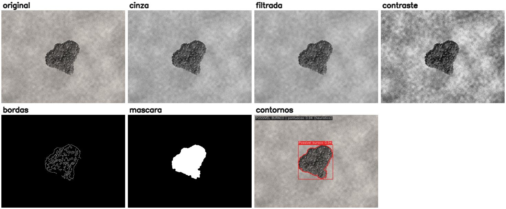
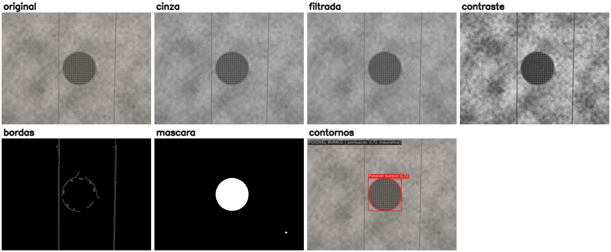
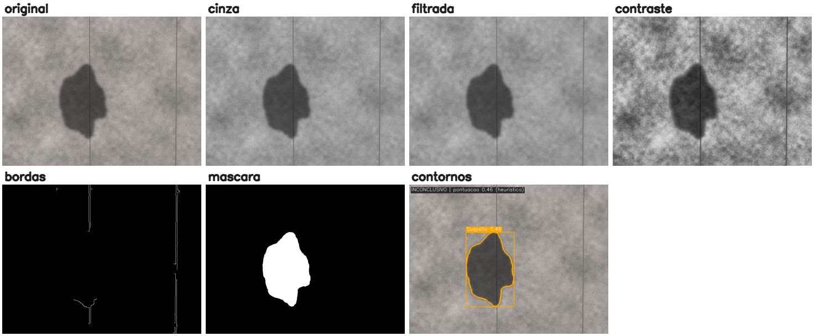

# AcessaCidade — Pitch Visão Computacional

**FIAP · Global Solution 2026.2 · CitizenTech · Engenharia de Software 4º ano**
**Disciplina:** Applied Computer Vision — Prof. Claudiney Sanches Junior
**Componente no MVP:** Visão — triagem automática das fotos de denúncias de acessibilidade
**Equipe:** [PREENCHER: nome da equipe] — [PREENCHER: nomes e RMs de todos os integrantes]
**Data de envio:** [PREENCHER: data]

## Links da entrega (clicáveis)

| Item | Link |
|---|---|
| Vídeo (até 5 min, todos os integrantes) | [PREENCHER: URL_VIDEO] |
| MVP em URL pública | [PREENCHER: URL_MVP] |
| Tela para testar a triagem sem registrar denúncia | [PREENCHER: URL_MVP]/#/analise |
| Repositório público | [PREENCHER: URL_REPOSITORIO] |
| Código da visão computacional | [04-Applied-Computer-Vision/src/acessacidade_vision](../src/acessacidade_vision) |
| Documentação técnica completa das transformações | [docs/DOCUMENTACAO_TECNICA_TRANSFORMACOES.md](DOCUMENTACAO_TECNICA_TRANSFORMACOES.md) |
| Imagens intermediárias geradas (uma pasta por foto) | [results/](../results) |
| Dados obtidos (CSV / JSON) | [results/dados_extraidos.csv](../results/dados_extraidos.csv) · [results/dados_extraidos.json](../results/dados_extraidos.json) |
| Comparação com rótulos manuais | [results/RELATORIO_COMPARACAO.md](../results/RELATORIO_COMPARACAO.md) · [results/comparacao_manual.csv](../results/comparacao_manual.csv) |
| Base de imagens de teste (sintéticas) | [data/samples/fotos/](../../data/samples/fotos) |

> Os links para arquivos do repositório viram endereços do GitHub no PDF quando `url_repositorio` é
> preenchido em `docs/links_entrega.yaml` (script `docs/gerar_pdf_relatorio.py`). Confira cada link em
> aba anônima antes do envio.

## 1. Problema e cidadão

Pessoas com deficiência, cadeirantes, pessoas idosas e pessoas com mobilidade reduzida enfrentam
buracos e calçadas danificadas no dia a dia. No AcessaCidade, o cidadão registra a denúncia com uma
foto; o componente de visão **olha a foto automaticamente**, separa o que parece um buraco do que
não parece ou do que não dá para avaliar, e entrega à equipe de revisão as imagens intermediárias,
as medidas e uma explicação em português. Isso acelera a triagem — mas **não substitui** a revisão
humana nem é avaliação técnica ou oficial.

## 2. Como funciona (fluxo automático)

Tudo roda de forma autônoma a cada foto recebida pelo backend (`POST /api/denuncias` e
`POST /api/visao/analisar`), sem intervenção manual: **valida → sanitiza → analisa → grava as 7 etapas**
(contrato de integração, seção 5). Em lote, `scripts/analisar_pasta.py` processa uma pasta inteira e
salva imagens e dados extraídos.

Técnica: **OpenCV clássico + NumPy**, sem redes neurais — cada decisão é explicável com números.

| # | Transformação | Operação | Parâmetros principais | Para quê |
|---|---|---|---|---|
| 0 | Validação | assinatura binária (JPEG/PNG/WEBP) + dimensões do cabeçalho + `cv2.imdecode` real | 64–8000 px; tamanho máximo do upload | rejeitar o que não é imagem e "bombas de descompressão" |
| 0 | Sanitização (privacidade) | re-encode JPEG (remove EXIF/GPS), redimensiona, borra rostos (Haar cascade do OpenCV) | maior lado 1600 px | LGPD |
| 1 | `original` | cópia de trabalho reduzida por área, sem ampliar | maior lado 800 px | limiares em pixels comparáveis entre celulares |
| 2 | `cinza` | luminância `Y = 0,299R + 0,587G + 0,114B` | — | buraco é sobretudo diferença de brilho |
| 3 | `filtrada` | convolução gaussiana `G(x,y) ∝ exp(−(x²+y²)/2σ²)` | kernel 5×5, σ = 1,1 | reduzir ruído e textura fina |
| — | Qualidade | histograma, contraste RMS, variância do Laplaciano | brilho 45–215; contraste ≥ 7; nitidez ≥ 30 | foto ruim → **inconclusiva** |
| 4 | `contraste` | CLAHE (equalização adaptativa limitada) | clipLimit 2,0; blocos 4×4 | realçar detalhes locais |
| 5 | `bordas` | Canny (gradiente de Sobel 3×3 + supressão de não máximos + histerese) | σ prévio 1,5; limiares 40/110 | medir borda abrupta no contorno |
| 6 | `mascara` | limiar das regiões escuras (Otsu + limiar robusto `mediana − max(28; 2,5·σ_rob)`, `σ_rob = 1,4826·MAD`) + morfologia (abertura e fechamento) | elipse 5×5 ×2 (abertura) e 11×11 (fechamento) | separar regiões candidatas |
| 7 | `contornos` | `cv2.findContours` + medidas + caixas delimitadoras com rótulos | área mínima 0,4%; até 8 candidatas | extrair dados de cada região |
| — | Regra explicável | portões mínimos + pontuação heurística ponderada (0–1, **não é probabilidade**) | possível buraco ≥ 0,60; inconclusivo ≥ 0,42 | decidir e explicar |

Detalhes matemáticos, todos os limiares e as justificativas:
[DOCUMENTACAO_TECNICA_TRANSFORMACOES.md](DOCUMENTACAO_TECNICA_TRANSFORMACOES.md).

Extras documentados: **transformação de perspectiva** opcional (homografia com 4 pontos,
`correct_perspective`) — fora do fluxo automático porque exige pontos confiáveis; **sem OCR**, de
propósito: texto na foto (placas, números de casas) não ajuda a ver buracos e pode identificar
pessoas e endereços.

## 3. Imagens intermediárias (exemplo real: `sintetica_buraco_01.jpg`)

Painel com as 7 etapas, gerado por `scripts/analisar_pasta.py`
([results/sintetica_buraco_01/painel_etapas.jpg](../results/sintetica_buraco_01/painel_etapas.jpg)):



| Etapa | O que mostra | Arquivo |
|---|---|---|
| original | foto sanitizada, redimensionada | [original.jpg](../results/sintetica_buraco_01/original.jpg) |
| cinza | luminância | [cinza.jpg](../results/sintetica_buraco_01/cinza.jpg) |
| filtrada | após a convolução gaussiana 5×5 | [filtrada.jpg](../results/sintetica_buraco_01/filtrada.jpg) |
| contraste | após CLAHE | [contraste.jpg](../results/sintetica_buraco_01/contraste.jpg) |
| bordas | mapa de bordas de Canny | [bordas.jpg](../results/sintetica_buraco_01/bordas.jpg) |
| mascara | regiões escuras após limiar e morfologia | [mascara.jpg](../results/sintetica_buraco_01/mascara.jpg) |
| contornos | contornos, caixa delimitadora e rótulo desenhados | [contornos.jpg](../results/sintetica_buraco_01/contornos.jpg) |
| resultado | classificação, pontuação, métricas e explicações (JSON) | [resultado.json](../results/sintetica_buraco_01/resultado.json) |

Contraexemplos (falso positivo e caso conservador), com as mesmas etapas:





## 4. Dados extraídos das imagens

Por imagem: dimensões, brilho médio, contraste RMS, nitidez (variância do Laplaciano), percentuais de
pixels escuros e saturados, histograma de 16 faixas, limiares (Otsu, robusto, aplicado), percentual da
máscara, densidade de bordas, número de candidatas. Por região candidata: área relativa, circularidade
(`4πA/P²`), solidez (área/área do fecho convexo), razão de aspecto, alongamento, contraste
interno/externo, textura relativa, razão e nitidez de bordas no contorno, gradiente de profundidade,
fração que toca a borda da imagem, caixa delimitadora (`x, y, largura, altura`), sub-pontuações e
critérios não atendidos. Saída: classificação, rótulo em português, pontuação heurística e explicações.

Resumo real das 25 imagens (extraído de `results/dados_extraidos.csv`, gerado em 2026-11-15; base
**SINTÉTICA**). "Área" e "Contraste int./ext." referem-se à melhor região candidata ("—" = nenhuma). Nomes sem o prefixo `sintetica_` e a extensão `.jpg`; cada nome abre o painel das etapas e "JSON" abre o resultado completo.

| Imagem (painel) | Rótulo manual (por construção) | Resultado da triagem | Pontuação | Brilho | Contraste RMS | Nitidez (Laplaciano) | Área | Solidez | Contraste int./ext. | Detecções | Dados |
|---|---|---|---:|---:|---:|---:|---:|---:|---:|---:|---|
| [baixo_contraste_01](../results/sintetica_baixo_contraste_01/painel_etapas.jpg) | INCONCLUSIVE | Análise inconclusiva | 0,00 | 149,5 | 3,5 | 3,5 | — | — | — | 0 | [JSON](../results/sintetica_baixo_contraste_01/resultado.json) |
| [borrada_01](../results/sintetica_borrada_01/painel_etapas.jpg) | INCONCLUSIVE | Análise inconclusiva | 0,75 | 105,5 | 15,8 | 1,6 | 7,5% | 0,95 | 0,48 | 0 | [JSON](../results/sintetica_borrada_01/resultado.json) |
| [buraco_01](../results/sintetica_buraco_01/painel_etapas.jpg) | POSSIBLE_POTHOLE | Possível buraco identificado | 0,94 | 164,6 | 25,8 | 133,8 | 6,6% | 0,91 | 0,51 | 1 | [JSON](../results/sintetica_buraco_01/resultado.json) |
| [buraco_02](../results/sintetica_buraco_02/painel_etapas.jpg) | POSSIBLE_POTHOLE | Possível buraco identificado | 0,91 | 99,3 | 21,4 | 271,1 | 10,5% | 0,87 | 0,49 | 1 | [JSON](../results/sintetica_buraco_02/resultado.json) |
| [buraco_03](../results/sintetica_buraco_03/painel_etapas.jpg) | POSSIBLE_POTHOLE | Possível buraco identificado | 0,98 | 146,1 | 24,8 | 138,9 | 6,1% | 0,92 | 0,50 | 1 | [JSON](../results/sintetica_buraco_03/resultado.json) |
| [buraco_04](../results/sintetica_buraco_04/painel_etapas.jpg) | POSSIBLE_POTHOLE | Possível buraco identificado | 0,93 | 150,1 | 15,8 | 148,0 | 2,2% | 0,86 | 0,48 | 1 | [JSON](../results/sintetica_buraco_04/resultado.json) |
| [buraco_05](../results/sintetica_buraco_05/painel_etapas.jpg) | POSSIBLE_POTHOLE | Possível buraco identificado | 0,92 | 156,6 | 31,9 | 120,9 | 4,4% | 0,92 | 0,51 | 1 | [JSON](../results/sintetica_buraco_05/resultado.json) |
| [buraco_06](../results/sintetica_buraco_06/painel_etapas.jpg) | POSSIBLE_POTHOLE | Possível buraco identificado | 0,97 | 116,3 | 22,1 | 270,2 | 9,1% | 0,89 | 0,48 | 1 | [JSON](../results/sintetica_buraco_06/resultado.json) |
| [buraco_07](../results/sintetica_buraco_07/painel_etapas.jpg) | POSSIBLE_POTHOLE | Possível buraco identificado | 0,94 | 163,3 | 22,5 | 137,4 | 5,4% | 0,92 | 0,47 | 1 | [JSON](../results/sintetica_buraco_07/resultado.json) |
| [buraco_com_agua_01](../results/sintetica_buraco_com_agua_01/painel_etapas.jpg) | POSSIBLE_POTHOLE | Possível buraco identificado | 0,60 | 116,7 | 18,8 | 244,1 | 7,4% | 0,87 | 0,47 | 1 | [JSON](../results/sintetica_buraco_com_agua_01/resultado.json) |
| [buraco_raso_01](../results/sintetica_buraco_raso_01/painel_etapas.jpg) | POSSIBLE_POTHOLE | Nenhum indício suficiente de buraco | 0,27 | 153,7 | 14,5 | 126,5 | 3,3% | 0,61 | 0,15 | 0 | [JSON](../results/sintetica_buraco_raso_01/resultado.json) |
| [calcada_lisa_01](../results/sintetica_calcada_lisa_01/painel_etapas.jpg) | NOT_IDENTIFIED | Nenhum indício suficiente de buraco | 0,00 | 158,4 | 12,6 | 116,9 | — | — | — | 0 | [JSON](../results/sintetica_calcada_lisa_01/resultado.json) |
| [calcada_lisa_02](../results/sintetica_calcada_lisa_02/painel_etapas.jpg) | NOT_IDENTIFIED | Nenhum indício suficiente de buraco | 0,00 | 107,4 | 11,3 | 256,7 | — | — | — | 0 | [JSON](../results/sintetica_calcada_lisa_02/resultado.json) |
| [calcada_lisa_03](../results/sintetica_calcada_lisa_03/painel_etapas.jpg) | NOT_IDENTIFIED | Nenhum indício suficiente de buraco | 0,00 | 140,6 | 15,7 | 121,2 | — | — | — | 0 | [JSON](../results/sintetica_calcada_lisa_03/resultado.json) |
| [clara_01](../results/sintetica_clara_01/painel_etapas.jpg) | INCONCLUSIVE | Análise inconclusiva | 0,54 | 252,3 | 13,3 | 36,6 | 3,2% | 0,57 | 0,19 | 0 | [JSON](../results/sintetica_clara_01/resultado.json) |
| [escura_01](../results/sintetica_escura_01/painel_etapas.jpg) | INCONCLUSIVE | Análise inconclusiva | 0,00 | 24,7 | 3,8 | 10,7 | — | — | — | 0 | [JSON](../results/sintetica_escura_01/resultado.json) |
| [mancha_01](../results/sintetica_mancha_01/painel_etapas.jpg) | NOT_IDENTIFIED | Análise inconclusiva | 0,52 | 165,6 | 19,5 | 108,7 | 4,9% | 0,93 | 0,43 | 1 | [JSON](../results/sintetica_mancha_01/resultado.json) |
| [mancha_02](../results/sintetica_mancha_02/painel_etapas.jpg) | NOT_IDENTIFIED | Nenhum indício suficiente de buraco | 0,31 | 131,0 | 20,5 | 112,4 | 9,7% | 0,92 | 0,31 | 0 | [JSON](../results/sintetica_mancha_02/resultado.json) |
| [poca_01](../results/sintetica_poca_01/painel_etapas.jpg) | NOT_IDENTIFIED | Análise inconclusiva | 0,59 | 98,1 | 20,6 | 220,7 | 14,8% | 0,94 | 0,44 | 1 | [JSON](../results/sintetica_poca_01/resultado.json) |
| [rachadura_01](../results/sintetica_rachadura_01/painel_etapas.jpg) | NOT_IDENTIFIED | Nenhum indício suficiente de buraco | 0,00 | 148,2 | 13,9 | 122,3 | — | — | — | 0 | [JSON](../results/sintetica_rachadura_01/resultado.json) |
| [rachadura_02](../results/sintetica_rachadura_02/painel_etapas.jpg) | NOT_IDENTIFIED | Nenhum indício suficiente de buraco | 0,00 | 119,4 | 14,0 | 266,7 | — | — | — | 0 | [JSON](../results/sintetica_rachadura_02/resultado.json) |
| [sombra_01](../results/sintetica_sombra_01/painel_etapas.jpg) | NOT_IDENTIFIED | Nenhum indício suficiente de buraco | 0,28 | 116,5 | 46,0 | 63,4 | 54,0% | 1,00 | 0,54 | 0 | [JSON](../results/sintetica_sombra_01/resultado.json) |
| [sombra_02](../results/sintetica_sombra_02/painel_etapas.jpg) | NOT_IDENTIFIED | Nenhum indício suficiente de buraco | 0,41 | 116,0 | 15,1 | 246,3 | 4,1% | 0,85 | 0,42 | 0 | [JSON](../results/sintetica_sombra_02/resultado.json) |
| [sombra_03](../results/sintetica_sombra_03/painel_etapas.jpg) | NOT_IDENTIFIED | Análise inconclusiva | 0,46 | 146,7 | 24,0 | 108,1 | 8,0% | 0,93 | 0,50 | 1 | [JSON](../results/sintetica_sombra_03/resultado.json) |
| [tampa_bueiro_01](../results/sintetica_tampa_bueiro_01/painel_etapas.jpg) | NOT_IDENTIFIED | Possível buraco identificado | 0,72 | 146,6 | 17,1 | 118,5 | 5,0% | 0,99 | 0,36 | 1 | [JSON](../results/sintetica_tampa_bueiro_01/resultado.json) |

## 5. Comparação com classificação manual

> **AVISO — BASE SINTÉTICA.** As imagens foram geradas por computador e o "rótulo manual" é o rótulo
> esperado por construção da cena. Gerador e regra foram escritos pela mesma equipe e os limiares
> foram ajustados olhando estas imagens: a concordância tende a ser **otimista**. Estes números
> **não medem o desempenho no mundo real** e **não são acurácia** do AcessaCidade.

Resultado copiado de [results/RELATORIO_COMPARACAO.md](../results/RELATORIO_COMPARACAO.md)
(gerado em 2026-11-15 01:51 UTC por `scripts/avaliar_comparacao.py`):

- Imagens comparadas: **25**
- Concordância total: **20/25** (80,0%) — concordância com o rótulo esperado por construção.

| Manual \ Predição | POSSÍVEL BURACO | NÃO IDENTIFICADO | INCONCLUSIVO | Total |
|---|---:|---:|---:|---:|
| **POSSÍVEL BURACO** | 8 | 1 | 0 | 9 |
| **NÃO IDENTIFICADO** | 1 | 8 | 3 | 12 |
| **INCONCLUSIVO** | 0 | 0 | 4 | 4 |

| Classe | Imagens | Acertos | Revocação | Precisão |
|---|---:|---:|---:|---:|
| POSSÍVEL BURACO | 9 | 8 | 88,9% | 88,9% |
| NÃO IDENTIFICADO | 12 | 8 | 66,7% | 88,9% |
| INCONCLUSIVO | 4 | 4 | 100,0% | 57,1% |

Erros discutidos:

| Imagem | Manual | Predição | Pontuação | Discussão |
|---|---|---|---:|---|
| [sintetica_buraco_raso_01.jpg](../results/sintetica_buraco_raso_01/painel_etapas.jpg) | POSSÍVEL BURACO | NÃO IDENTIFICADO | 0,2723 | Falso negativo: buraco raso, pouco contraste |
| [sintetica_tampa_bueiro_01.jpg](../results/sintetica_tampa_bueiro_01/painel_etapas.jpg) | NÃO IDENTIFICADO | POSSÍVEL BURACO | 0,7229 | Falso positivo: disco escuro com relevo e aro abrupto — a regra não distingue objetos fabricados |
| [sintetica_sombra_03.jpg](../results/sintetica_sombra_03/painel_etapas.jpg) | NÃO IDENTIFICADO | INCONCLUSIVO | 0,4628 | Sombra compacta: erro conservador (vai para revisão humana) |
| [sintetica_mancha_01.jpg](../results/sintetica_mancha_01/painel_etapas.jpg) | NÃO IDENTIFICADO | INCONCLUSIVO | 0,5175 | Mancha escura sem rugosidade: erro conservador |
| [sintetica_poca_01.jpg](../results/sintetica_poca_01/painel_etapas.jpg) | NÃO IDENTIFICADO | INCONCLUSIVO | 0,5928 | Poça com borda nítida e fundo liso: erro conservador; na prática pode esconder um buraco |

**Base real:** [PREENCHER: resultado da comparação com fotos reais rotuladas manualmente
(`samples/real/`), quando existir — número de fotos, matriz de confusão e discussão]. Até lá, não há
medição de desempenho no mundo real.

## 6. Testes automatizados (resultado real)

```text
.\.venv\Scripts\python.exe -m pytest 04-Applied-Computer-Vision/tests
45 passed   (execução local em 2026-11-15, Windows 11, Python 3.11.9)
```

Cobrem: validação (bytes inválidos, imagem pequena, tamanho), sanitização sem EXIF, todas as etapas e
chaves de `to_dict`, classes válidas, determinismo, imagem escura → inconclusiva, buraco sintético →
possível buraco, calçada lisa → não identificado, correção de perspectiva.

## 7. Integração com o MVP

- Backend: `POST /api/visao/analisar` (testar a foto sem registrar) e `POST /api/denuncias` (registro
  com foto) usam `validate_image_bytes → sanitize_image → analyze_image → encode_stages()`; as etapas
  são gravadas em `DATA_DIR/uploads/<uuid>/<etapa>.jpg` (a "original" salva é a sanitizada).
- Frontend: `#/analise` (testar a triagem) e `#/denuncia/{protocolo}` (detalhe com todas as etapas).
- Status: denúncia com foto passa automaticamente para **Aguardando revisão**.
- Verificado localmente em 15/11/2026 (testes da API e E2E 199/199 contra o backend real).
  [PREENCHER: confirmar na URL pública que as duas rotas funcionam — depende do deploy da disciplina 06].

## 8. Limites, vieses e revisão humana

- Falsos positivos esperados: sombras compactas, manchas, poças, tampas de bueiro, rachaduras largas,
  juntas escuras, pedra portuguesa. Falsos negativos: buracos rasos, cheios de água, da cor do piso ou
  fotografados de longe.
- Medidas em pixels: sem referência de tamanho não há área nem profundidade em cm.
- Só procura indícios de **buraco**; outros problemas (rampa, piso tátil, obstáculo) dependem da
  descrição e da revisão humana.
- Celulares de entrada geram fotos piores → mais "inconclusiva"; por isso a foto é opcional e a
  triagem não muda prioridade nem descarta denúncias.
- Toda triagem vai para revisão humana (`CONFIRMADO` / `DESCARTADO`); a visão nunca decide sozinha.

## 9. Checklist antes do envio

- [ ] Vídeo publicado (YouTube público ou não listado), até 5 min, com todos os integrantes.
- [ ] URL pública do MVP funcionando (`#/analise` e registro com foto).
- [ ] Repositório público com `results/` e `data/samples/fotos/` versionados.
- [ ] Links preenchidos em `docs/links_entrega.yaml` e PDF gerado com `--estrito`.
- [ ] Cada link do PDF aberto em aba anônima.
- [ ] (Recomendado) Comparação com fotos reais incluída na seção 5.
- [ ] Envio no portal até 19/11/2026, 23h55 — um envio por equipe.
