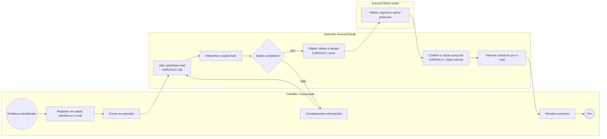
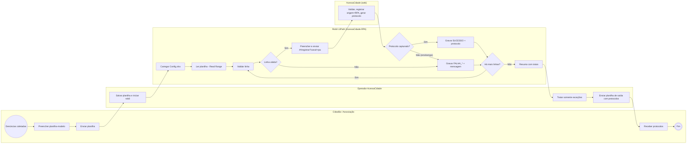

# Mapeamento de processos — cadastro de denúncias recebidas de parceiros

Processo escolhido: **cadastro, no AcessaCidade, de denúncias de acessibilidade recebidas por canais não digitais
e por planilhas de parceiros** (associações de pessoas com deficiência, ONGs e agentes comunitários).

> Cenário de demonstração com dados **fictícios/simulados** na cidade fictícia "Cidade Exemplo". Volumes e tempos
> citados aqui são **premissas** (ver `../docs/BUSINESS_CASE.md`), não medições.

## Arquivos

| Arquivo | O que é | Como abrir |
|---|---|---|
| `AS-IS_cadastro_denuncias.bpmn` | BPMN 2.0 XML com diagrama (pool, raias, tarefas, gateways, anotações de gargalo) | https://demo.bpmn.io → *Open diagram* (ou arrastar o arquivo), ou Camunda Modeler → *File > Open File* |
| `TO-BE_cadastro_denuncias.bpmn` | Idem, processo com o robô | idem |
| `AS-IS_cadastro_denuncias.svg` / `TO-BE_cadastro_denuncias.svg` | Renderização simplificada desenhada pelo script a partir das mesmas coordenadas | Qualquer navegador |
| `../scripts/gerar_bpmn.py` | Gera os quatro arquivos acima | `.\.venv\Scripts\python.exe 05-Robotic-Process-Automation\scripts\gerar_bpmn.py` |

Notação: `userTask` = tarefa feita por pessoa no sistema; `manualTask` = tarefa fora do sistema (papel, conversa);
`serviceTask` = tarefa automática (robô ou sistema); `sendTask`/`receiveTask` = envio/recebimento de mensagem;
losango com X = gateway exclusivo (decisão). Anotações em vermelho marcam gargalos (As-Is) ou observações (To-Be).

---

## 1. AS-IS (situação atual — cadastro manual)

### Raias

| Raia | Papel |
|---|---|
| **Cidadão / Associação** | Pessoa com deficiência, idoso ou agente comunitário relata o problema; a associação junta os relatos em papel, planilha ou e-mail. |
| **Operador AcessaCidade** | Pessoa da equipe que transcreve cada relato para o formulário web. |
| **AcessaCidade (web)** | Valida os campos, grava a denúncia e gera o protocolo `AC-AAAA-NNNNNN`. |

### Narrativa

1. Um problema de acessibilidade é identificado (buraco, calçada quebrada, rampa ausente, obstáculo).
2. A associação registra o relato em papel, planilha própria ou e-mail — cada parceiro com um formato diferente.
3. A associação envia a planilha/e-mail ao operador.
4. O operador abre o material recebido (**gargalo 1**: os arquivos acumulam na caixa de e-mail e o cadastro depende da agenda do operador).
5. O operador interpreta e padroniza endereço, tipo de obstáculo e impacto, convertendo o texto livre para as categorias do sistema.
6. **Decisão "Dados completos?"** — se faltar algo (ex.: bairro), o operador pede complemento à associação, que responde e o ciclo volta ao passo 4.
7. Com os dados completos, o operador **digita campo a campo** no formulário (**gargalo 2**: cerca de 10 campos por denúncia, risco de erro de digitação e de categoria).
8. O AcessaCidade valida, registra e mostra o protocolo.
9. O operador confere o cadastro e **copia o protocolo manualmente** (**gargalo 3**: risco de associar o protocolo à denúncia errada).
10. O operador informa os protocolos à associação por e-mail; a associação recebe e repassa aos cidadãos.

### Gargalos e problemas

| # | Gargalo | Efeito para o cidadão |
|---|---|---|
| 1 | Fila de planilhas/e-mails dependente da disponibilidade do operador | Denúncia demora a entrar no sistema e na análise |
| 2 | Digitação manual de ~10 campos por denúncia | Erros de endereço/categoria; triagem e indicadores distorcidos |
| 3 | Cópia manual do protocolo | Cidadão pode receber protocolo errado e não conseguir acompanhar |
| 4 | Sem registro de quais linhas foram cadastradas | Risco de duplicidade ou de esquecer linhas |

### Mermaid (AS-IS)

---

## 2. TO-BE (com o robô UiPath — operador trata só exceções)

### Raias

| Raia | Papel |
|---|---|
| **Cidadão / Associação** | Preenche a **planilha-modelo padronizada** (mesmas colunas e rótulos do formulário) e a envia. |
| **Operador AcessaCidade** | Coloca a planilha na pasta de entrada, inicia o robô, trata **somente** as linhas com falha e devolve os protocolos. |
| **Robô UiPath (AcessaCidade.RPA)** | Lê a planilha, valida cada linha, preenche o formulário `#/registrar?canal=rpa`, captura o protocolo e registra o resultado. |
| **AcessaCidade (web)** | Valida, grava a denúncia com `origem=RPA` e gera o protocolo. |

### Narrativa

1. A associação preenche a planilha-modelo (colunas `Nome`, `Logradouro`, `Numero`, `Bairro`, `Cidade`, `Ponto_Referencia`,
   `Tipo_Obstaculo`, `Descricao`, `Impacto`, `Caminho_Imagem`, `Data_Registro`) e envia ao AcessaCidade.
2. O operador salva a planilha na pasta configurada em `Config.xlsx` e inicia o robô (no futuro: disparo agendado).
3. **Robô** carrega a configuração (`CarregarConfiguracao.xaml`) e lê a planilha (Read Range).
4. Para cada linha, o robô **valida** as regras do contrato (tamanhos mínimos/máximos, rótulos de tipo e impacto, imagem existente).
5. **Decisão "Linha válida?"** — se não, grava `FALHA_NEGOCIO` e a mensagem na planilha de saída, sem enviar nada.
6. Se válida, o robô preenche o formulário pelos **ids estáveis** (`#campo-logradouro`, `#campo-tipo`…), anexa a foto (opcional),
   marca o consentimento e clica em `#botao-enviar`.
7. O AcessaCidade valida, registra com `origem=RPA` e exibe o protocolo em `#protocolo-gerado`.
8. **Decisão "Protocolo capturado?"** — sim: grava `SUCESSO` + protocolo; não (mensagem em `#erro-envio` ou tempo esgotado):
   grava `FALHA_NEGOCIO` (recusa do sistema) ou `FALHA_SISTEMA` (técnica) com a mensagem.
9. **Decisão "Há mais linhas?"** — volta ao passo 4; ao final, o robô registra um resumo com os totais no log.
10. O operador abre a planilha de saída, **trata só as exceções** (corrige e reprocessa — linhas com `SUCESSO` são ignoradas
    numa nova execução, evitando duplicidade) e envia a planilha de saída com os protocolos à associação.

### O que muda

| Aspecto | AS-IS | TO-BE |
|---|---|---|
| Digitação | Operador, campo a campo | Robô, pelos ids do formulário |
| Validação | Visual, pelo operador | Regras explícitas do contrato antes do envio |
| Protocolo | Copiado manualmente | Capturado de `#protocolo-gerado` e gravado na linha correta |
| Rastreabilidade | Nenhuma | Planilha de saída com status, mensagem e data/hora por linha + `origem=RPA` no sistema |
| Papel do operador | Executor | Supervisor de exceções |

### Mermaid (TO-BE)

---

## 3. Validação dos arquivos BPMN

- `tests/test_rpa_artefatos.py` verifica que os `.bpmn` são XML bem-formado, que cada elemento de fluxo
  (eventos, tarefas, gateways), raia, anotação e o participante têm `BPMNShape`, que cada `sequenceFlow`/`association`
  tem `BPMNEdge` com pelo menos 2 waypoints e que `incoming`/`outgoing` batem com os fluxos.
- Conferência visual: abrir no https://demo.bpmn.io e exportar a imagem (*Download as SVG/PNG*) para o relatório
  (ação manual — ver `../PENDENCIAS_E_ACOES_MANUAIS.txt`).
