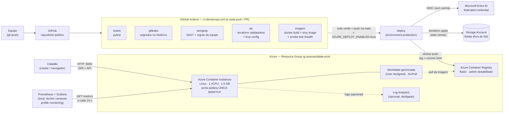
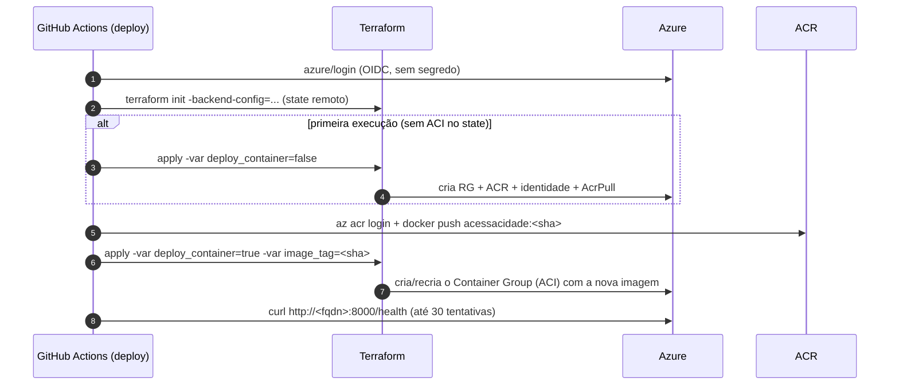

# AcessaCidade — Arquitetura de nuvem e entrega contínua

> Disciplina 06 — Secure DevOps Tools & Cloud Computing ("Deploy Blindado").
> Reaproveita o conceito do exercício de referência **Calango TI**: imagem no
> **Azure Container Registry (ACR)** e execução no **Azure Container Instances (ACI)**,
> agora descritos em **Terraform** e publicados por **GitHub Actions** com barreiras de segurança.

## 1. Visão geral (do commit ao cidadão)

## 2. Componentes

| Camada | Recurso | Como é criado | Segurança aplicada |
|---|---|---|---|
| Código | Repositório GitHub | Manual (equipe) | Gitleaks + Semgrep em todo push; segredos só em GitHub Secrets |
| CI/CD | GitHub Actions (`.github/workflows/ci-devsecops.yml`) | Versionado | `permissions: contents: read`; OIDC só no job de deploy; actions e ferramentas com versão fixa |
| Imagem | `06-Secure-DevOps-Cloud/docker/Dockerfile` | `docker build` no CI | Multi-stage, `python:3.11-slim-bookworm`, usuário 10001, sem pip/setuptools na imagem final, sem segredos, HEALTHCHECK |
| Registro | Azure Container Registry (Basic) | Terraform (fase 1) | `admin_enabled = false`; push via Entra ID; pull via identidade gerenciada (AcrPull) |
| Execução | Azure Container Instances | Terraform (fase 2) | Somente 8000/TCP; segredos em `secure_environment_variables`; probes `/health`; `restart_policy = Always` |
| Identidade | User Assigned Managed Identity | Terraform (fase 1) | Menor privilégio: apenas AcrPull no ACR do projeto |
| State | Storage Account + container `tfstate` | `infra/azure/02_state_remoto.*` (uma vez) | Sem chave compartilhada (`--allow-shared-key-access false`), HTTPS only, acesso por Entra ID |
| Observabilidade | Prometheus + Grafana + Alertmanager | `docker compose --profile monitoring` (local) | Portas ligadas só em `127.0.0.1`; Grafana sem senha padrão; sem acesso anônimo |

## 3. Implantação em duas fases (Terraform)

Por que duas fases: o ACI só consegue iniciar se a imagem já existir no ACR. A fase 1 cria o registro;
o push acontece entre as fases; a fase 2 cria o container apontando para a tag do commit.

## 4. Portas e superfície de ataque

| Porta | Onde | Exposição |
|---|---|---|
| 8000/TCP | ACI (aplicação: SPA, API, `/health`, `/metrics`, `/docs`) | Pública (única) |
| 22 (SSH), 3389 (RDP) | — | **Não existem.** O ACI não é uma VM; não há porta administrativa. Diagnóstico por `az container logs` / `az container exec` (API autenticada da Azure) |
| 9090, 9093, 3000 | Prometheus, Alertmanager, Grafana (máquina da equipe) | Somente `127.0.0.1` |

O teste `06-Secure-DevOps-Cloud/terraform/tests/acessacidade.tftest.hcl` e a validação da variável
`app_port` impedem que outra porta seja publicada; o teste `test_devops_terraform.py` impede porta 22/3389 e `0.0.0.0/0`.

## 5. Limitações conhecidas e evolução proposta

| Limitação (MVP) | Impacto | Evolução proposta |
|---|---|---|
| **Armazenamento efêmero no ACI**: SQLite e fotos ficam em `/app/data/runtime` dentro do container | Ao recriar o container (novo deploy, reinício do host) as denúncias reais são perdidas; o seed de demonstração (`SEED_DEMO_DATA=true`) é recriado | Montar **Azure Files** no container group (volume) ou migrar para **Azure Database for PostgreSQL** + **Blob Storage** para as fotos |
| **Sem HTTPS nativo** no ACI (HTTP na porta 8000) | Tráfego sem criptografia em trânsito; navegadores marcam "não seguro" | **Azure Container Apps** (HTTPS gerenciado e certificado automático) ou ACI atrás de **Application Gateway / Front Door** com TLS e WAF |
| `/metrics` público | Expõe contadores operacionais (sem dados pessoais) | Proteger por rede privada/VNet ou autenticação no proxy; Azure Monitor managed Prometheus |
| Uma réplica | Sem alta disponibilidade | Container Apps com escala mínima 2 ou AKS |
| Prometheus/Grafana locais | Monitoramento só enquanto a máquina da equipe está ligada | Azure Monitor + Managed Grafana, ou Grafana Cloud |

## 6. Onde está cada arquivo

| Item | Caminho |
|---|---|
| Dockerfile | `06-Secure-DevOps-Cloud/docker/Dockerfile` |
| Compose | `docker-compose.yml` (raiz) |
| Terraform | `06-Secure-DevOps-Cloud/terraform/` |
| Alternativa manual (YAML do ACI + scripts az) | `infra/` |
| Workflow | `.github/workflows/ci-devsecops.yml` |
| Regras Semgrep / Gitleaks | `.semgrep/acessacidade.yml`, `.gitleaks.toml` |
| Monitoramento | `06-Secure-DevOps-Cloud/monitoring/` |
| Scripts locais | `scripts/run_local.ps1`, `scripts/run_local.sh`, `scripts/gerar_trafego_demo.py` |
