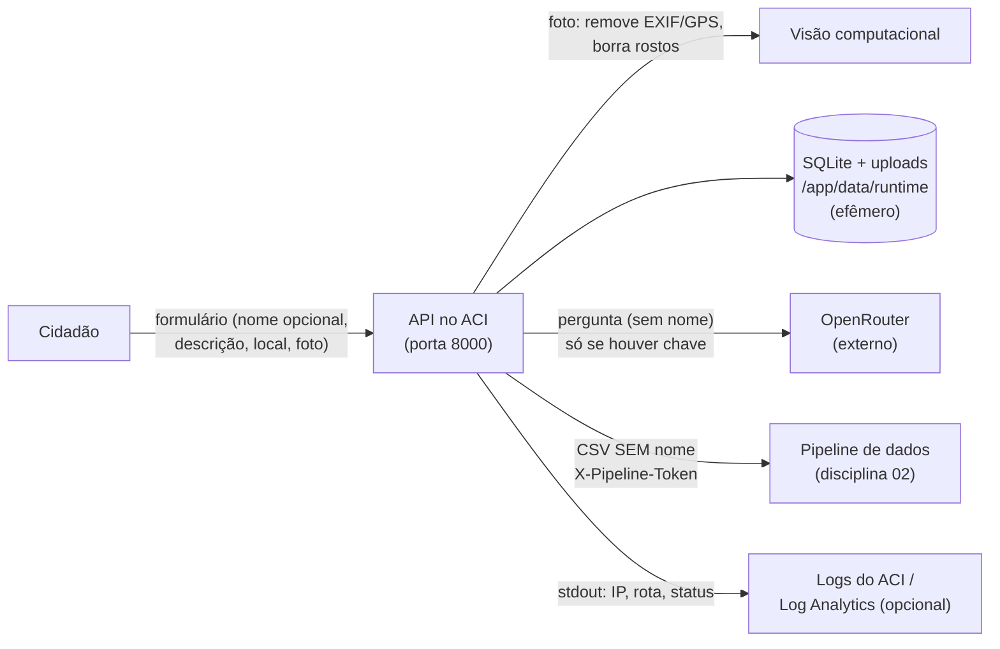

# LGPD — Onde ficam os dados pessoais do AcessaCidade

> Mapeamento de dados pessoais (Lei 13.709/2018) para a arquitetura publicada (ACI + ACR) e para
> as ferramentas de desenvolvimento. Regras normativas: `docs/CONTRATOS_DE_INTEGRACAO.md`, seção 11.
> Este documento é técnico e não substitui parecer jurídico. Itens marcados com [PREENCHER] dependem
> de decisão da equipe.

## 1. Inventário

| # | Dado | Pessoal? | Onde fica (MVP publicado) | Quem acessa | Proteção aplicada | Retenção |
|---|---|---|---|---|---|---|
| 1 | Nome do denunciante (opcional) | **Sim** | SQLite em `/app/data/runtime` **dentro do container ACI** | Somente a aplicação; nunca retornado pela API nem exportado | Campo opcional; excluído das respostas públicas e da exportação do pipeline | Efêmero no MVP (apagado ao recriar o container); política definitiva: [PREENCHER: prazo, ex. até a conclusão da denúncia + N dias] |
| 2 | Descrição livre da denúncia | Pode conter (se o cidadão escrever nome, telefone etc.) | SQLite no container; exportação CSV para o pipeline (disciplina 02) | Público (texto da denúncia), equipe | Orientação na interface para não incluir dados pessoais; [PREENCHER: se houver mascaramento automático, citar] | Mesma da denúncia |
| 3 | Localização (rua/bairro de referência, coordenadas se informadas) | Indireto (pode revelar rotina) | SQLite no container; Gold do pipeline (agregado) | Público (local do problema) | Refere-se ao **problema**, não à pessoa; pipeline agrega por bairro | Mesma da denúncia |
| 4 | Foto da calçada | Pode conter rosto, placa, pessoa | Uploads em `/app/data/runtime` no container | Público (miniatura na denúncia) | Re-encode remove EXIF/GPS, redimensionamento, borramento de rostos (visão computacional, disciplina 04) | Mesma da denúncia |
| 5 | Endereço IP do visitante | **Sim** | Memória do processo (limite de requisições por minuto); logs de acesso do Uvicorn (stdout do container) | Equipe (via `az container logs`); Azure (plataforma) | Logs não registram nome, chave nem conteúdo das fotos | Logs do ACI acompanham o container (perdidos ao recriar); Log Analytics opcional: `log_analytics_retention_days` (padrão 30) |
| 6 | Pergunta enviada ao assistente | Pode conter | Enviada ao **OpenRouter** (provedor externo, fora do Brasil) quando `OPENROUTER_API_KEY` está definida; caso contrário, processada só localmente (modo alternativo por regras) | OpenRouter e o modelo escolhido | Guardrails do helper (disciplina 01); não enviar nome do denunciante; sem chave = nenhuma transferência | Conforme política do OpenRouter/modelo: [PREENCHER: verificar termos e retenção do provedor escolhido] |
| 7 | Métricas Prometheus | **Não** | `/metrics` (contadores agregados por rota/status) e Prometheus local | Equipe | Rótulo `route` usa template (sem IDs); nenhum dado pessoal | 7 dias (`--storage.tsdb.retention.time=7d`) |
| 8 | Código-fonte, issues, logs do CI | Não deveria conter | GitHub (repositório público) | Público | Gitleaks barra segredos; dados de teste são **simulados** ("Cidade Exemplo") | Histórico do Git (permanente) — por isso nenhum dado real entra no repositório |
| 9 | Segredos (tokens, chave do OpenRouter) | Não pessoal, mas sensível | GitHub Secrets → `secure_environment_variables` do ACI | Somente o pipeline e o container | Nunca no código, na imagem ou no state em texto aberto no Git | Rotacionar ao fim da avaliação |
| 10 | State do Terraform | Pode conter valores sensíveis (segredos passados ao ACI) | Storage Account (container `tfstate`), fora do Git | Service principal do CI e equipe | Sem chave compartilhada, HTTPS only, acesso por Entra ID | Apagar junto com os recursos ao fim da avaliação |

## 2. Fluxo dos dados pessoais

## 3. Bases legais sugeridas (art. 7º da LGPD) — validar com a equipe/orientação

| Tratamento | Base legal sugerida | Observação |
|---|---|---|
| Registro da denúncia (local, descrição, foto) | Consentimento (art. 7º, I) informado na tela de envio, ou legítimo interesse (art. 7º, IX) com teste de balanceamento | [PREENCHER: base escolhida pela equipe] |
| Nome opcional | Consentimento (campo opcional, finalidade explicada) | Sem nome a denúncia funciona igual (minimização) |
| IP em logs e limite de requisições | Legítimo interesse — segurança e prevenção de abuso | Retenção curta |
| Envio ao assistente de IA (OpenRouter) | Consentimento com aviso de transferência internacional (art. 33) | Modo alternativo local quando não houver consentimento/chave |

## 4. Minimização e privacidade por padrão

- Nome é **opcional** e nunca sai do banco (não é retornado nem exportado).
- Fotos são re-codificadas (sem metadados EXIF/GPS) e têm rostos borrados antes de salvar.
- Dados de demonstração são **simulados** (`simulado=true`, "Cidade Exemplo"), sem nomes reais.
- Métricas não têm dados pessoais; rótulos de rota sem IDs.
- Sem a variável `OPENROUTER_API_KEY`, nenhum dado vai para terceiros.
- O AcessaCidade **não é serviço oficial do governo**: a interface deixa claro que o status
  "Resolvida" é registro da equipe.

## 5. Direitos do titular (art. 18) — como atender no MVP

| Direito | Como atender | Situação |
|---|---|---|
| Confirmação e acesso | Consulta da denúncia pelo protocolo | Disponível (dados públicos da denúncia) |
| Correção / eliminação | Pedido ao canal da equipe; remoção manual no banco | [PREENCHER: canal de contato da equipe (e-mail institucional)] |
| Informação sobre compartilhamento | Este documento + aviso na interface (OpenRouter) | [PREENCHER: confirmar o aviso na interface] |
| Revogação do consentimento | Mesmo canal; exclusão da denúncia ou do nome | [PREENCHER] |
| Encarregado (DPO) | Projeto acadêmico: responsável indicado pela equipe | [PREENCHER: nome do responsável da equipe] |

## 6. Riscos e próximos passos

| Risco | Mitigação atual | Próximo passo |
|---|---|---|
| Tráfego HTTP sem TLS (ACI) | Nenhum dado sensível obrigatório; nome é opcional | HTTPS via Azure Container Apps / Front Door |
| Perda de dados ao recriar o container | Aceito no MVP (demonstração) | Azure Files / PostgreSQL com backup e criptografia |
| Texto livre com dados pessoais | Orientação na interface | Detecção/mascaramento de telefone, CPF e e-mail no backend |
| Logs com IP retidos indefinidamente | Log Analytics desligado por padrão; quando ligado, retenção de 30 dias | Definir retenção mínima necessária |
