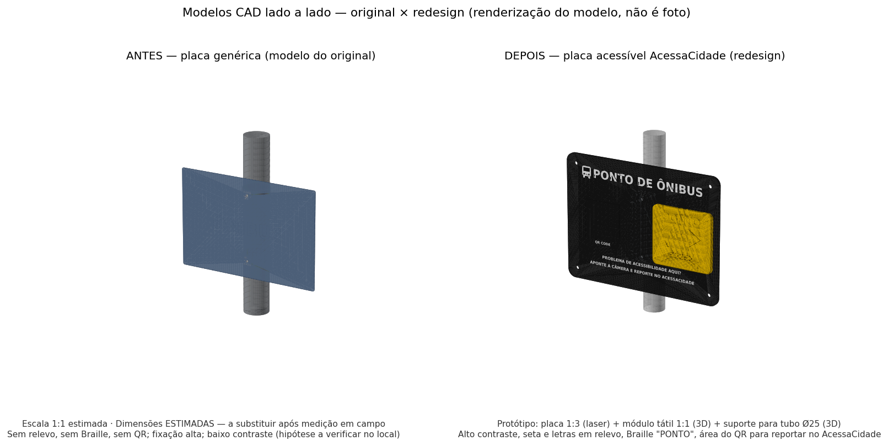
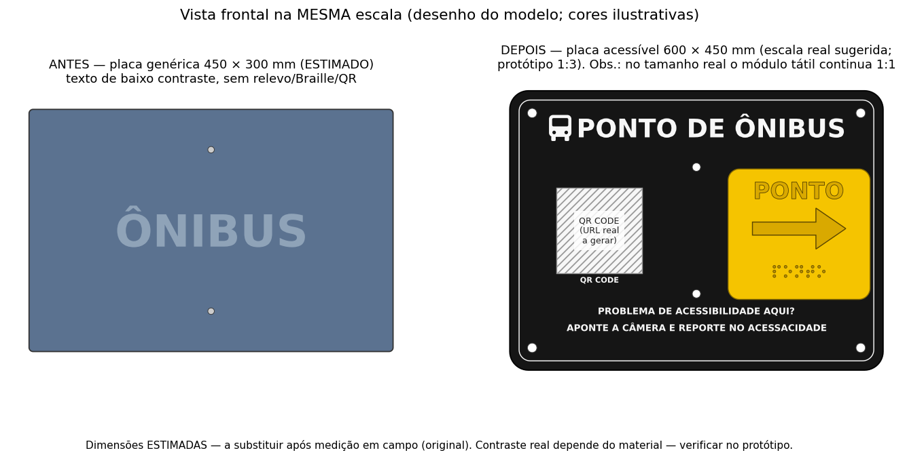
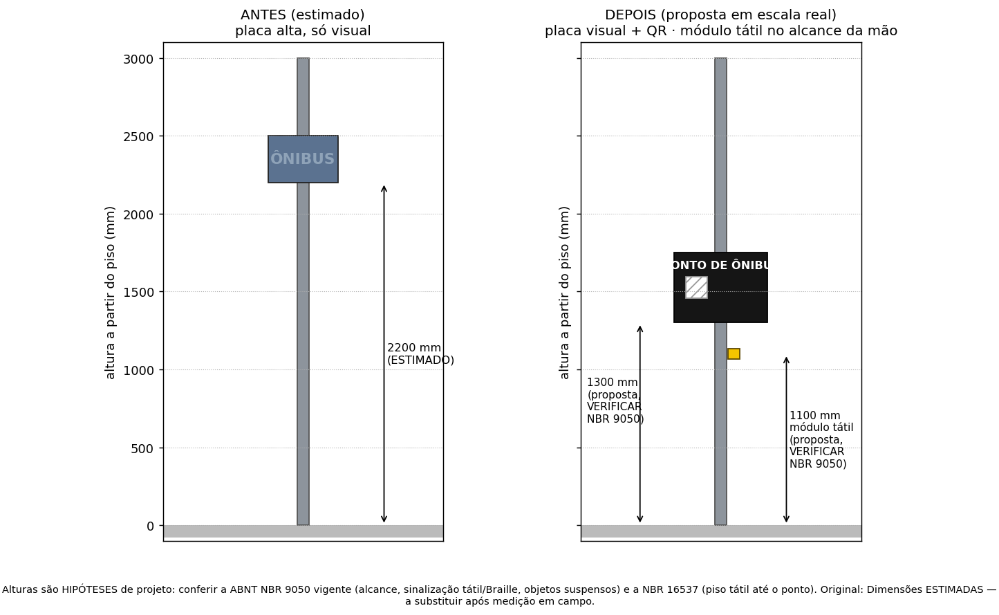
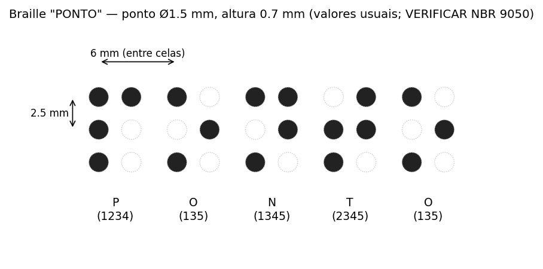
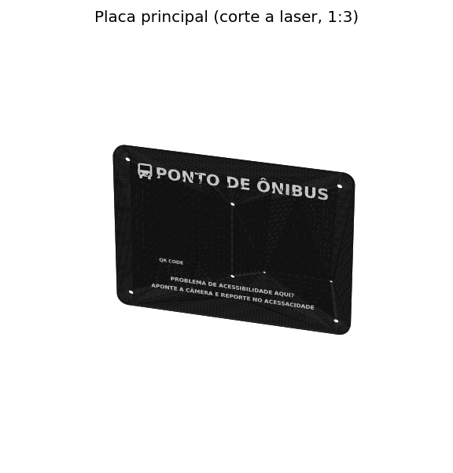
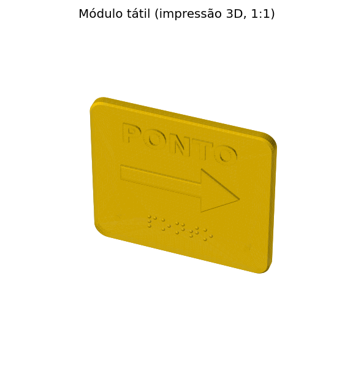
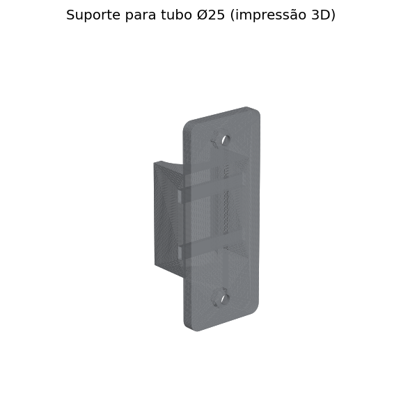

# Antes × depois — original e redesign lado a lado

> Imagens geradas a partir dos modelos CAD (não são fotos). Fotos reais do local e do protótipo:
> [PREENCHER: inserir após a visita e a fabricação — ver `FOTOS_A_REALIZAR.md`].

## 1. Modelos CAD lado a lado

## 2. Tabela comparativa

| Aspecto | ANTES — placa genérica (hipótese a verificar) | DEPOIS — placa acessível AcessaCidade | Quem ganha |
|---|---|---|---|
| Dimensões | ~450 × 300 mm (ESTIMADO) | 600 × 450 mm real sugerido (protótipo 200 × 150, 1:3) | Baixa visão |
| Altura de instalação | borda inferior ~2,2 m (ESTIMADO) | placa com borda inferior ~1,3 m e módulo tátil com centro ~1,1 m (verificar NBR 9050) | Cadeirantes, baixa estatura, baixa visão |
| Contraste | baixo (claro sobre azul/cinza, desbotado) | branco sobre preto fosco + módulo amarelo | Baixa visão, idosos |
| Informação tátil | nenhuma | letras "PONTO" em relevo 1 mm, seta 1,5 mm, Braille "PONTO" | Pessoas cegas |
| Sentido de embarque | não indicado | seta em relevo (sentido definido no local) | Pessoas cegas e com baixa visão |
| Canal de reporte | nenhum | QR Code → `#/registrar` do AcessaCidade | Todos os cidadãos |
| Bordas | quinas vivas de chapa metálica (hipótese) | cantos R10 (placa) e R6 + chanfro 0,8 (módulo) | Quem se orienta pelo tato |
| Fixação | abraçadeiras metálicas improvisadas (hipótese) | suporte impresso com berço para o tubo + abraçadeiras de nylon + parafusos M4 | Manutenção, segurança |
| Fabricação | chapa metálica + pintura/adesivo | laser (placa) + impressão 3D (módulo, suporte) — reproduzível em Fab Lab | Prefeituras, Fab Labs |
| Dados abertos | — | arquivos STEP/DXF/SVG/STL/3MF e código paramétrico publicados | Comunidade maker |

## 3. Detalhe do módulo tátil

## 4. Peças do redesign

| Placa (laser) | Módulo tátil (3D) | Suporte (3D) |
|---|---|---|
|  |  |  |

## 5. Antes e depois com fotos reais (preencher)

| Antes (foto no local) | Depois (foto do protótipo montado) |
|---|---|
| [PREENCHER: `fotos/local_02_frontal.jpg`] | [PREENCHER: `fotos/prototipo_frontal.jpg`] |
| [PREENCHER: `fotos/local_06_superficie.jpg`] | [PREENCHER: `fotos/prototipo_tatil_mao.jpg`] |

O ganho para o cidadão é uma **hipótese a validar** (ver `IMPACTO_E_ODS.md`): sugerimos um teste simples
com o protótipo (leitura do QR por celulares diferentes, legibilidade a 1 m, identificação tátil de seta e
Braille com olhos vendados por integrantes da equipe), registrando os resultados reais.
