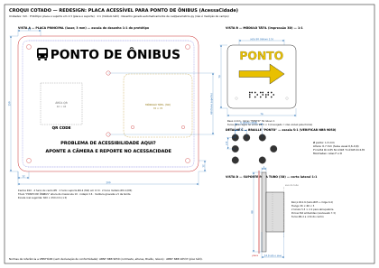
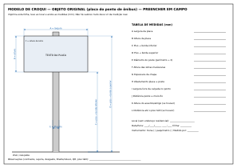
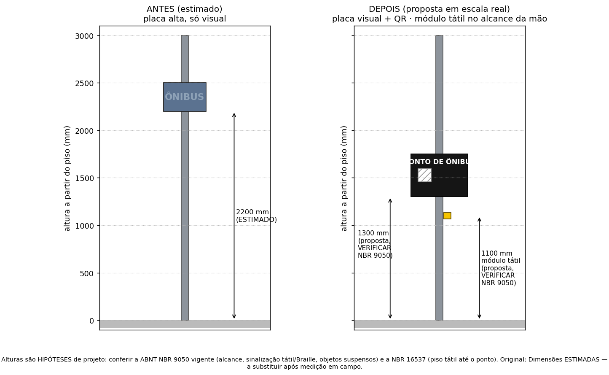

# Croquis com medidas

## 1. Croqui cotado do REDESIGN (gerado por script)

- Arquivo: [`imagens/croqui_redesign.svg`](imagens/croqui_redesign.svg) — gerado por `cad/imagens.py`
  (`croqui_redesign`) a partir de `cad/parametros.py`; sempre coerente com o CAD.
- Unidades: mm. Placa e suporte em **escala 1:3** do tamanho real sugerido; módulo tátil em **1:1**.
- Para imprimir em A4/A3: abra o SVG no navegador ou no Inkscape e imprima em "tamanho real" (100%).

Medidas principais (protótipo):

| Elemento | Medida |
|---|---|
| Placa principal | 200 × 150 × 3 mm, cantos R10 |
| Furos de canto (4×) | Ø5,0 mm a 12 mm das bordas |
| Furos do suporte (2×) | Ø4,4 mm em (0, ±34) a partir do centro |
| Furos do módulo (2×) | Ø3,4 mm, alinhados aos furos-guia do módulo |
| Área reservada do QR | 46 × 46 mm (com zona de silêncio de 4 módulos), centro em (−52, 0) |
| Título "PONTO DE ÔNIBUS" | letras maiúsculas de 10 mm (real ≈ 30 mm) |
| Módulo tátil | 76 × 70 mm, base 4 mm, centro em (55, −2) |
| Seta em relevo | 50 mm de comprimento, relevo 1,5 mm |
| Braille "PONTO" | ponto Ø1,5 × 0,7 mm; 2,5 mm entre pontos; 6 mm entre celas |
| Suporte para tubo | flange 36 × 88 × 5 mm; berço para tubo Ø25 (+0,4 mm de folga) |

Valores de Braille, relevo e alturas de instalação são **de referência usual — verificar na ABNT NBR 9050**.

## 2. Croqui do ORIGINAL — modelo a preencher no local

- Arquivo: [`imagens/croqui_original_A_PREENCHER.svg`](imagens/croqui_original_A_PREENCHER.svg).
- Imprima, leve ao ponto de ônibus e preencha à mão as letras A–L (mesmas letras de
  [`GUIA_FOTOGRAFAR_E_MEDIR.md`](GUIA_FOTOGRAFAR_E_MEDIR.md)).
- Fotografe o croqui preenchido e salve como `docs/imagens/croqui_original_preenchido.jpg`
  [PREENCHER: foto do croqui preenchido].

| Letra | Medida | Valor medido (mm) |
|---|---|---|
| A | Largura da placa | [PREENCHER] |
| B | Altura da placa | [PREENCHER] |
| C | Piso → borda inferior | [PREENCHER] |
| D | Piso → borda superior | [PREENCHER] |
| E | Diâmetro do poste | [PREENCHER] |
| F | Altura das letras | [PREENCHER] |
| G | Espessura da chapa | [PREENCHER] |
| H | Afastamento placa ↔ poste | [PREENCHER] |
| I | Largura livre da calçada | [PREENCHER] |
| J | Poste ↔ meio-fio | [PREENCHER] |
| K | Altura do assento/abrigo | [PREENCHER] |
| L | Distância ao piso tátil | [PREENCHER] |

Até a medição, o CAD do original usa as **estimativas** do bloco "OBJETO ORIGINAL" de `cad/parametros.py`
(450 × 300 × 2 mm, borda inferior a 2200 mm, poste Ø76,2 mm).

## 3. Instalação em escala real (proposta)

Proposta (a validar com a NBR 9050 e com o órgão responsável): módulo tátil com centro a ~1100 mm do piso e
placa visual com borda inferior a ~1300 mm, ambos no mesmo poste, projeção lateral alvo ≤ 100 mm.
