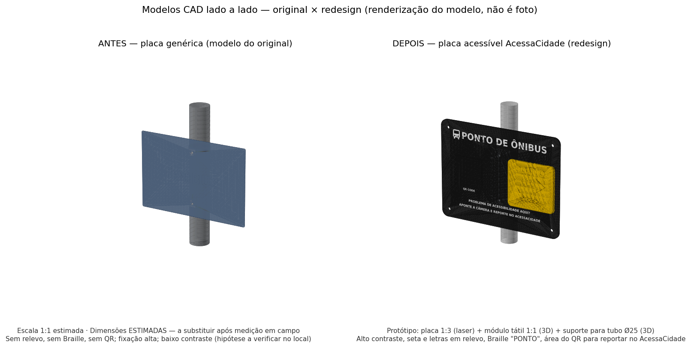
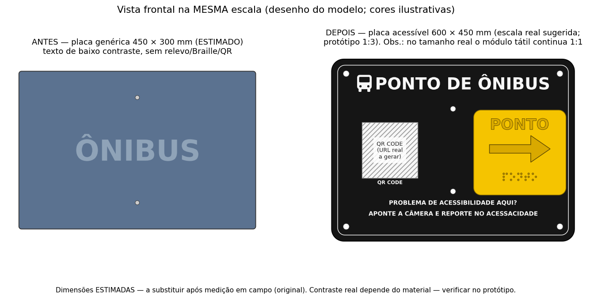

# AcessaCidade — Placa acessível para ponto de ônibus
## Project-Based Maker Lab · "CitizenTech: Cidade remodelada" · FIAP Global Solution 2026.2

> Fonte do **PDF único** de entrega. Substitua todos os [PREENCHER] antes de exportar.
> Como gerar o PDF: abra este arquivo no VS Code com a extensão *Markdown PDF* (ou cole no Google Docs/Word),
> confira as imagens e exporte em PDF. **Teste cada link no PDF final** (critério "links clicáveis funcionando").

| | |
|---|---|
| Equipe | [PREENCHER: nomes completos e RMs] |
| Turma | [PREENCHER] |
| Professora | Thais Aparecida Fernandes Kabuchi |
| **Publicação no MakerWorld** | [PREENCHER: link do MakerWorld] |
| **Repositório / pasta dos arquivos** | [PREENCHER: link do repositório]/tree/main/07-Project-Based-Maker-Lab |
| Documento Onshape (se usado) | [PREENCHER: link] |
| Vídeo (bônus, ≤ 2 min) | [PREENCHER: link] |
| Aplicação AcessaCidade (destino do QR) | [PREENCHER: URL pública]/#/registrar |

---

## 1. Escolher e observar — diagnóstico (2,0)

**Objeto:** placa de identificação de ponto de ônibus em [PREENCHER: local público de referência], visitada em
[PREENCHER: data].

[PREENCHER: 2–4 fotos do local — `docs/fotos/local_01_contexto.jpg`, `local_02_frontal.jpg`, `local_04_altura.jpg`, `local_06_superficie.jpg`]

**Quem é afetado e por quê** (manter só o que foi confirmado no local):
- Pessoas cegas: sem relevo/Braille, não confirmam que chegaram ao ponto nem o sentido de embarque. [PREENCHER: confirmado?]
- Pessoas com baixa visão e idosas: letras pequenas, baixo contraste e placa alta. [PREENCHER: confirmado?]
- Cadeirantes e pessoas de baixa estatura: leitura em ângulo, placa fora do alcance. [PREENCHER: confirmado?]
- Todos: não há canal para reportar problemas de acessibilidade do entorno. [PREENCHER: confirmado?]

Detalhes: `docs/DIAGNOSTICO_OBJETO_ORIGINAL.md`.

## 2. Medir — croqui

[PREENCHER: foto do croqui preenchido — `docs/imagens/croqui_original_preenchido.jpg`]

| Medida | Valor medido (mm) |
|---|---|
| Largura × altura da placa | [PREENCHER] |
| Piso → borda inferior | [PREENCHER] |
| Diâmetro do poste | [PREENCHER] |
| Altura das letras | [PREENCHER] |
| Espessura da chapa | [PREENCHER] |
| Instrumentos | [PREENCHER: trena / paquímetro] |

Croqui cotado do redesign: `docs/imagens/croqui_redesign.svg` (inserir a imagem).

## 3. Modelar o original — CAD (2,0)

Modelo paramétrico em CadQuery (`cad/modelo_original.py`), simplificado ao que importa para o problema:
placa, altura de instalação, poste e abraçadeiras; sem relevo, sem Braille, sem QR. Arquivos:
`cad/original_placa_ESTIMADO.step`, `cad/original_montagem_ESTIMADO.step`.
[PREENCHER: confirmar que as medidas reais substituíram as estimativas — `ORIGINAL_MEDIDO_EM_CAMPO = True` — e renomear a legenda das imagens se necessário]

## 4. Redesenhar — CAD do redesign lado a lado (3,0)

| Peça | Processo | Dimensões | Arquivos |
|---|---|---|---|
| Placa principal | Laser (MDF/acrílico 3 mm) | 200 × 150 × 3 mm (1:3) | `laser-cut/placa_principal_laser.dxf/.svg`, `cad/redesign_placa_principal_laser.step` |
| Módulo tátil | Impressão 3D | 76 × 70 × 5,5 mm (1:1) | `3d-print/modulo_tatil.stl/.3mf`, `cad/redesign_modulo_tatil_3d.step` |
| Suporte para tubo | Impressão 3D | 36 × 88 × 24,9 mm (1:3) | `3d-print/suporte_tubo.stl/.3mf`, `cad/redesign_suporte_tubo_3d.step` |
| Montagem | — | — | `cad/redesign_montagem.step` |

Braille "PONTO": ponto Ø1,5 × 0,7 mm, 2,5 mm entre pontos, 6 mm entre celas; seta em relevo 1,5 mm.
Valores usuais de referência — verificar na ABNT NBR 9050 (não declaramos conformidade).

## 5. Fabricar (3,0)

[PREENCHER: fotos reais — laser cortando, placa cortada, peças impressas, protótipo montado]

| Item | Valor real |
|---|---|
| Máquina laser / parâmetros | [PREENCHER] |
| Impressora / fatiador / tempos | [PREENCHER] |
| Materiais | [PREENCHER] |

Procedimento completo: `docs/FABRICACAO.md`.

## 6. Comparar e publicar — antes e depois + ODS (2,0)

| Antes (foto) | Depois (foto do protótipo) |
|---|---|
| [PREENCHER] | [PREENCHER] |

| O que falhava | O que mudou | Ganho para o cidadão |
|---|---|---|
| Informação só visual, alta, baixo contraste | Alto contraste, placa mais baixa, módulo amarelo | Leitura por quem tem baixa visão |
| Sem informação tátil | Relevo, seta, Braille | Pessoa cega identifica o ponto e o sentido |
| Sem canal de reporte | QR → AcessaCidade `#/registrar` | Problemas do entorno viram denúncias rastreáveis |

Resultados dos testes com o protótipo: [PREENCHER: resultados reais — ver `IMPACTO_E_ODS.md`].

**ODS:** ODS 11 (metas 11.2 e 11.7), ODS 10 (meta 10.2) e ODS 9 (meta 9.1) — detalhes em `docs/IMPACTO_E_ODS.md`.

## 7. Publicação no MakerWorld (1,5)

Link: [PREENCHER: link do MakerWorld] · Título, descrição, fotos, arquivos e crédito conforme
`docs/MAKERWORLD_PUBLICACAO.md`. [PREENCHER: print da página publicada]

## 8. Bônus

- Peça baixada integrada: [PREENCHER: nome] por [PREENCHER: autor] — [PREENCHER: link], licença [PREENCHER];
  função: [PREENCHER]. A placa, o módulo tátil e o suporte são autoria da equipe.
- Vídeo (≤ 2 min): [PREENCHER: link].

## 9. Integração com o AcessaCidade

O QR gravado leva à tela de registro de denúncias do AcessaCidade (mesmo produto das demais disciplinas).
O QR foi gerado com `laser-cut/gerar_qrcode.py --url [PREENCHER: URL pública]` em [PREENCHER: data] e lido com
sucesso em [PREENCHER: nº] celulares. Projeto acadêmico, não oficial.
