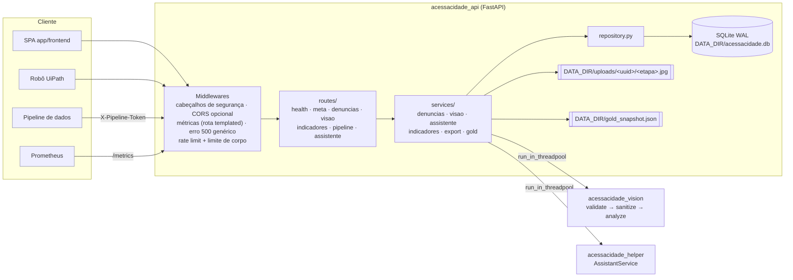

# AcessaCidade — Backend (API FastAPI)

API do MVP do **AcessaCidade** (FIAP Global Solution 2026.2 — CitizenTech, ODS 11): registra denúncias de
problemas de acessibilidade em calçadas e espaços públicos, faz a **triagem automática da fotografia** com o
pacote de visão computacional (`acessacidade_vision`), responde dúvidas pelo **AcessaCidade Helper**
(`acessacidade_helper`), publica indicadores e exporta dados anonimizados para o pipeline de dados.
Também serve o frontend estático (`app/frontend`) na raiz `/`.

> O AcessaCidade **não é serviço oficial do governo**. A triagem por imagem é **apoio** e sempre requer
> revisão humana; o status "Resolvida" é um registro da equipe, não confirmação de órgão público.

Contrato normativo: [`docs/CONTRATOS_DE_INTEGRACAO.md`](../../docs/CONTRATOS_DE_INTEGRACAO.md) (seções 3, 4, 10 e 11).

---

## 1. Como rodar localmente (Windows / PowerShell)

Pré-requisito: venv na raiz com as dependências (`python -m pip install -r requirements-dev.txt`).

```powershell
cd <raiz do repositório>
Copy-Item .env.example .env        # opcional; sem .env valem os padrões
.\.venv\Scripts\python.exe -m uvicorn acessacidade_api.main:app --app-dir app/backend --host 127.0.0.1 --port 8000
```

Abra `http://127.0.0.1:8000/` (frontend), `http://127.0.0.1:8000/docs` (Swagger) e `http://127.0.0.1:8000/health`.

- `--app-dir app/backend` coloca o pacote `acessacidade_api` no caminho de importação; o próprio
  `acessacidade_api/__init__.py` adiciona `01-Generative-AI-Engineering/src` e `04-Applied-Computer-Vision/src`
  ao `sys.path` quando os pacotes não estão importáveis (contrato 2.1).
- No Docker o `PYTHONPATH` já aponta para as três pastas e o comando é
  `uvicorn acessacidade_api.main:app --host 0.0.0.0 --port 8000 --proxy-headers`.
- Na primeira inicialização com `SEED_DEMO_DATA=true` (padrão) e banco vazio, são carregadas
  **28 denúncias SIMULADAS** da "Cidade Exemplo" (ver seção 6).

## 2. Variáveis de ambiente

Fonte de verdade: `.env.example` na raiz. Um arquivo `.env` na raiz é lido manualmente (sem dependência extra);
variáveis já definidas no ambiente têm prioridade.

| Variável | Padrão | Uso no backend |
|---|---|---|
| `APP_ENV` | `development` | Aparece em `/health` (`ambiente`) |
| `APP_PORT` | `8000` | Informativo (a porta real é a do comando uvicorn) |
| `LOG_LEVEL` | `INFO` | Nível do log JSON |
| `DATA_DIR` | `./data/runtime` | SQLite, `uploads/` e `gold_snapshot.json`. Relativo = a partir da raiz do repositório |
| `DATABASE_PATH` | vazio | Caminho do SQLite; vazio = `DATA_DIR/acessacidade.db` |
| `MAX_UPLOAD_MB` | `5` | Tamanho máximo da foto (lido em streaming; acima → 413) |
| `SEED_DEMO_DATA` | `true` | Carrega o seed simulado se a tabela estiver vazia |
| `CIDADE_PADRAO` | vazio | Cidade quando o campo vem vazio (vazio → "Não informada") |
| `RATE_LIMIT_PER_MINUTE` | `30` | Limite por IP e por rota em `POST /api/denuncias`, `POST /api/visao/analisar`, `POST /api/assistente` |
| `ALLOWED_ORIGINS` | vazio | CORS só é ativado se definido (lista separada por vírgulas) |
| `ADMIN_TOKEN` | vazio | Token da equipe (`X-Admin-Token`). Vazio → PATCH de status responde 403 |
| `PIPELINE_TOKEN` | vazio | Token do pipeline (`X-Pipeline-Token`). Vazio → export e Gold respondem 403 |
| `OPENROUTER_API_KEY`, `OPENROUTER_MODEL`, `OPENROUTER_BASE_URL`, `ASSISTANT_TIMEOUT_SECONDS` | — | Repassadas ao `AssistantService.from_env()`. Sem chave → modo `fallback` |
| `FRONTEND_DIR` | `app/frontend` | Pasta servida como estático em `/` |
| `SEED_FOTOS_DIR` | `data/samples/fotos` | (interna, opcional) pasta das imagens sintéticas usadas pelo seed |

Gere tokens com `python -c "import secrets; print(secrets.token_urlsafe(32))"` e **nunca** os versione.

## 3. Endpoints

| Método | Rota | Descrição | Proteção |
|---|---|---|---|
| GET | `/health` | Saúde (`SELECT 1` no banco). 200 `ok` / 503 `degradado` | — |
| GET | `/metrics` | Métricas Prometheus | — |
| GET | `/api/meta/opcoes` | Enumerações `{chave, rotulo[, significado]}` + `etapas_imagem`, `max_upload_mb` | — |
| GET | `/api/denuncias` | Lista paginada (`status`, `bairro`, `tipo_obstaculo`, `protocolo`, `incluir_simulados`, `pagina`, `limite`) | — |
| POST | `/api/denuncias` | Cria denúncia (multipart; `foto` opcional) → 201 | rate limit |
| GET | `/api/denuncias/{ref}` | Detalhe por id **ou** protocolo (com `historico`) | — |
| GET | `/api/denuncias/{id}/imagens/{etapa}` | JPEG da etapa (`original`, `cinza`, `filtrada`, `contraste`, `bordas`, `mascara`, `contornos`) | — |
| PATCH | `/api/denuncias/{id}/status` | Status / revisão humana; `observacao` obrigatória para ENCAMINHADA e RESOLVIDA | `X-Admin-Token` |
| POST | `/api/visao/analisar` | Analisa uma foto sem salvar nada (imagens em `data:` URI) | rate limit |
| GET | `/api/indicadores` | Indicadores operacionais em tempo real (`por_dia` ordenado) | — |
| GET | `/api/indicadores/analiticos` | Último snapshot Gold ou `{"disponivel": false, "mensagem": ...}` | — |
| POST | `/api/pipeline/gold` | Pipeline publica o snapshot Gold (objeto JSON com `gerado_em`; até 5 MB) | `X-Pipeline-Token` |
| GET | `/api/export/denuncias?formato=csv\|json` | Exportação anonimizada (sem nome) | `X-Pipeline-Token` |
| POST | `/api/assistente` | Pergunta ao AcessaCidade Helper (`fonte`: `llm` ou `fallback`) | rate limit |
| GET | `/docs`, `/openapi.json` | Documentação interativa | — |
| GET | `/` | Frontend estático (SPA) | — |

Erros sempre em `{"detail": ...}` em português:
- **422** de validação: `detail` é uma lista `[{"loc": [...], "campo": "descricao", "msg": "A descrição deve ter pelo menos 10 caracteres.", "type": "..."}]`
  (formato compatível com `extrairDetalhes()` do frontend); erros de imagem/negócio simples vêm como string.
- **401** token incorreto/ausente; **403** funcionalidade desativada (token não configurado); **404**; **413** foto/corpo grande demais;
  **429** com cabeçalho `Retry-After`; **500** com mensagem genérica, sem stacktrace.

Exemplo (PowerShell, com `curl.exe`):

```powershell
curl.exe -s http://127.0.0.1:8000/health
curl.exe -s -X POST http://127.0.0.1:8000/api/denuncias `
  -F logradouro="Rua Exemplo" -F bairro="Centro" -F tipo_obstaculo=BURACO_CALCADA `
  -F descricao="Buraco grande na calçada em frente ao ponto." -F impacto=IMPEDE_PASSAGEM `
  -F consentimento=true -F "foto=@data/samples/fotos/sintetica_buraco_01.jpg;type=image/jpeg"
```

## 4. Arquitetura interna



Fluxo de `POST /api/denuncias` com foto:

```mermaid
sequenceDiagram
  participant C as Cliente
  participant M as Middleware
  participant A as Rota
  participant V as acessacidade_vision
  participant D as SQLite
  C->>M: multipart (campos + foto)
  M->>M: rate limit por IP; Content-Length / bytes > limite → 413
  M->>A: requisição
  A->>A: lê a foto em blocos de 64 KB (para em MAX_UPLOAD_MB → 413)
  A->>A: valida campos (422 em pt-BR)
  A->>V: validate_image_bytes → sanitize_image → analyze_image(sanitizada) [threadpool]
  V-->>A: AnalysisResult + 7 etapas JPEG
  A->>A: grava uploads/<uuid4>/<etapa>.jpg (nunca o arquivo bruto)
  A->>D: INSERT (RECEBIDA) + histórico; UPDATE → AGUARDANDO_REVISAO + histórico
  A-->>C: 201 Denuncia (sem nome) + mensagem
```

| Arquivo | Responsabilidade |
|---|---|
| `acessacidade_api/__init__.py` | Versão, `REPO_ROOT` e bootstrap do `sys.path` (contrato 2.1) |
| `config.py` | `Settings` a partir do ambiente (+ `.env` opcional) |
| `db.py` | Conexão SQLite (WAL, `foreign_keys`, `busy_timeout`) e migração idempotente (`schema_version`) |
| `domain.py` | Enumerações e rótulos (contrato 3), protocolo `AC-AAAA-NNNNNN`, datas ISO UTC |
| `repository.py` | SQL de denúncias e histórico (consultas parametrizadas) |
| `schemas.py` | Modelos Pydantic v2 de entrada/saída (a resposta pública não tem campo `nome`) |
| `services/` | Regras de negócio: validação, triagem, assistente, indicadores, exportação, Gold |
| `routes/` | Rotas HTTP |
| `metrics.py` | Métricas da seção 10 e middleware ASGI |
| `security.py` | Cabeçalhos da seção 11, rate limit em memória, limite de corpo, `verificar_token` (`secrets.compare_digest`) |
| `errors.py` | Tradução de erros de validação para português, handler HTTP e middleware de erro 500 |
| `logging_config.py` | Log JSON lines com lista branca de campos (sem nome, chave ou conteúdo de foto) |
| `seed/` | `denuncias_demo.json` (simulado) e carregador |
| `main.py` | `create_app()` (fábrica), `lifespan` (migração + seed), montagem do estático após as rotas |

Banco: tabelas `denuncias`, `historico_status` (FK com `ON DELETE CASCADE`) e `schema_version`, com índices
em `criado_em`, `status`, `bairro`, `tipo_obstaculo`, `simulado` e `historico_status(denuncia_id)`.
O protocolo é gerado na mesma transação do INSERT a partir do ano de `criado_em` e do id.

## 5. Segurança e LGPD (contrato 11)

- **Nome do denunciante**: opcional, gravado só no SQLite; nunca sai na API, na exportação, nos indicadores, nos logs nem no assistente.
- **Fotos**: validadas por decodificação real (não pela extensão), re-encode sem EXIF/GPS, redimensionadas e com rostos
  borrados pelo pacote de visão; a "original" salva é a imagem sanitizada. Pastas com nome uuid4; a rota de imagens
  aceita só etapas de `STAGE_ORDER` e resolve o caminho dentro de `DATA_DIR/uploads` (sem path traversal).
- **Cabeçalhos** em todas as respostas (API, estáticos e erros): CSP `default-src 'self'; img-src 'self' data: blob:;
  style-src 'self'; script-src 'self'; connect-src 'self'; frame-ancestors 'none'`, `X-Content-Type-Options: nosniff`,
  `Referrer-Policy: no-referrer`, `X-Frame-Options: DENY`, `Permissions-Policy: camera=(), microphone=(), geolocation=(self)`.
- **Tokens**: comparados com `secrets.compare_digest`; não configurado → 403; errado → 401.
- **Rate limit**: janela deslizante de 60 s por IP e por rota, verificado **antes** de ler o corpo; 429 com `Retry-After`.
- **Erros**: 500 com mensagem genérica; o log registra apenas o tipo da exceção e a rota.

## 6. Dados de demonstração (seed)

`acessacidade_api/seed/denuncias_demo.json`: 28 denúncias **SIMULADAS** (`origem=SIMULADO`, `simulado=true`) na cidade
fictícia "Cidade Exemplo", bairros genéricos (Centro, Vila Esperança, Jardim Primavera, Parque das Flores, Vila Nova,
Jardim Aurora), datas fixas entre 2026-09-01 e 2026-11-13, status apenas RECEBIDA / EM_ANALISE / AGUARDANDO_REVISAO.
Onze itens citam uma imagem **sintética** de `data/samples/fotos/`: ao carregar o seed, cada imagem é processada **de
verdade** pelo pacote de visão (o resultado gravado é o real, não um valor inventado). Se a pasta não existir (ex.:
imagem Docker sem amostras), a denúncia é criada sem foto e com status RECEBIDA. O seed só roda com a tabela vazia
(idempotente).

## 7. Testes

```powershell
.\.venv\Scripts\python.exe -m pytest app/backend/tests
```

Cada teste usa `DATA_DIR` temporário (`tmp_path`), variáveis via `monkeypatch`, um frontend mínimo temporário e a
fábrica `create_app()`. Arquivos: `test_api_basico.py`, `test_api_denuncias.py`, `test_api_pipeline.py`,
`test_api_assistente.py`, `test_api_seed.py`.

Resultado registrado em 2026-11-15 (Windows 11, Python 3.11 do `.venv`): **56 passed** em ~16 s; suíte completa do
repositório: **485 passed** (492 após a inclusão dos testes da disciplina 03, auditoria de 15/11/2026).

## 8. Decisões

- **Sem dependências novas**: só o que está em `requirements.txt` (FastAPI, Uvicorn, python-multipart, OpenCV, NumPy,
  httpx, prometheus-client). `.env` lido por um parser simples próprio.
- **Conexão SQLite curta por operação**: segura entre as threads do threadpool; WAL permite leituras concorrentes.
- **Visão e helper em threadpool** (`run_in_threadpool`) para não bloquear o event loop.
- **Rate limit e limite de corpo como middleware ASGI**: rodam antes do parsing do multipart.
- **Métricas com rota templated** (`request.scope["route"].path`); estáticos agrupados em `/{estatico}` e rotas de API
  inexistentes em `/api/{caminho:path}`.
- **`/docs` com CSP própria**: o Swagger UI precisa do CDN `cdn.jsdelivr.net` e de um script inline; só essa página recebe uma
  CSP que libera esse CDN e o hash SHA-256 exato do script inline (sem `unsafe-eval`). Sem internet, `/docs` não carrega os
  assets do CDN, mas `/openapi.json` continua disponível.
- **Campo de arquivo vazio** (navegadores enviam `filename=""`) é tratado como "sem foto".

## 9. Limitações

- **SQLite em container efêmero** (Azure Container Instances sem volume): o banco, as fotos e o snapshot Gold se perdem
  quando o container é recriado; o seed volta a ser carregado. Para produção: volume persistente (Azure Files) ou PostgreSQL.
- **Rate limit em memória**: vale por processo/instância; com várias réplicas, usar um armazenamento compartilhado (ex.: Redis)
  ou o limite do gateway. Atrás de proxy, o IP real depende de `--proxy-headers`/`--forwarded-allow-ips` do uvicorn.
- **Um único worker recomendado**: o seed e as métricas em memória pressupõem um processo (para vários workers seria preciso
  `PROMETHEUS_MULTIPROC_DIR`).
- **Exportação CSV** entrega o texto como digitado (sem proteção contra fórmulas de planilha), pois é consumida pelo pipeline;
  ao abrir no Excel, importe como texto.
- A triagem é heurística (OpenCV clássico) e foi exercitada aqui apenas com **imagens sintéticas**; nenhum resultado destes
  testes mede desempenho em fotos reais.
