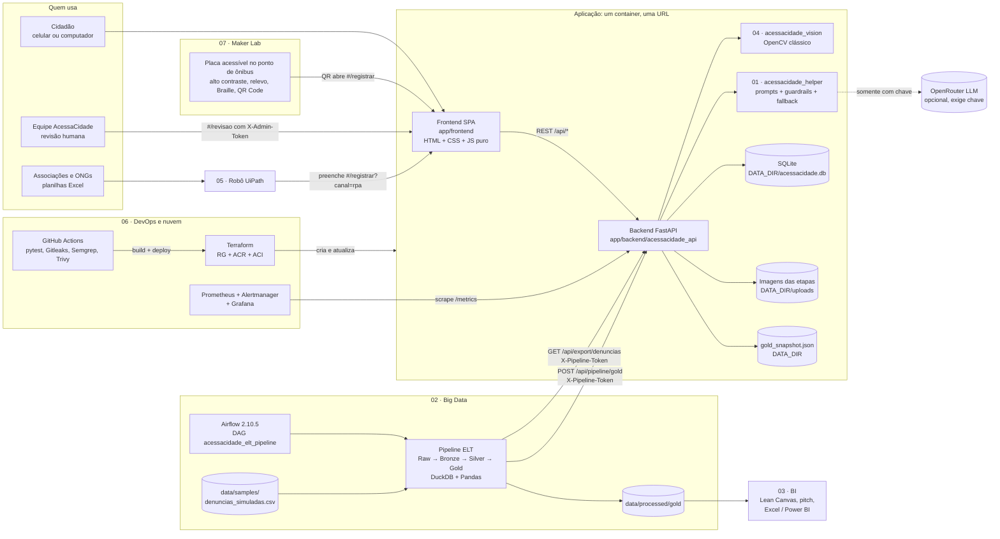
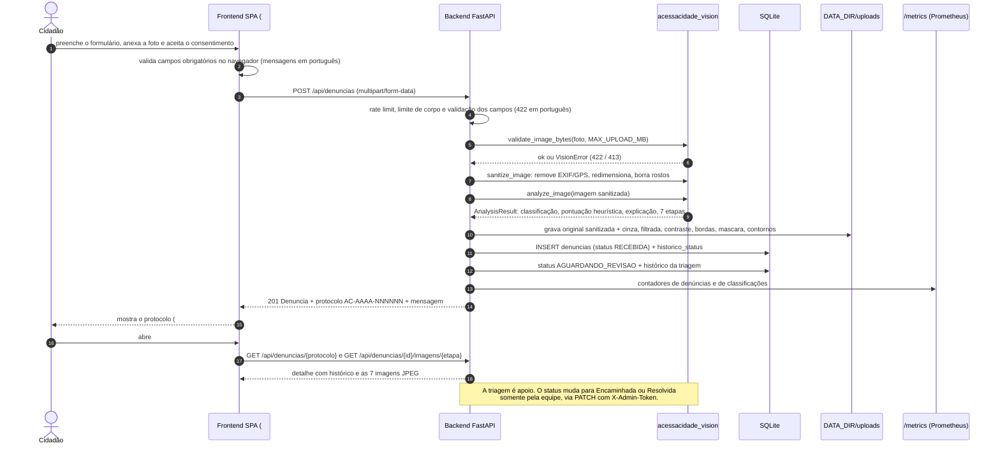
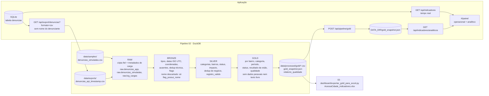
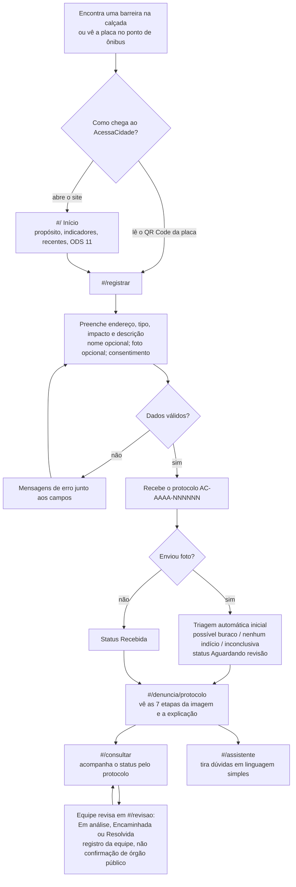
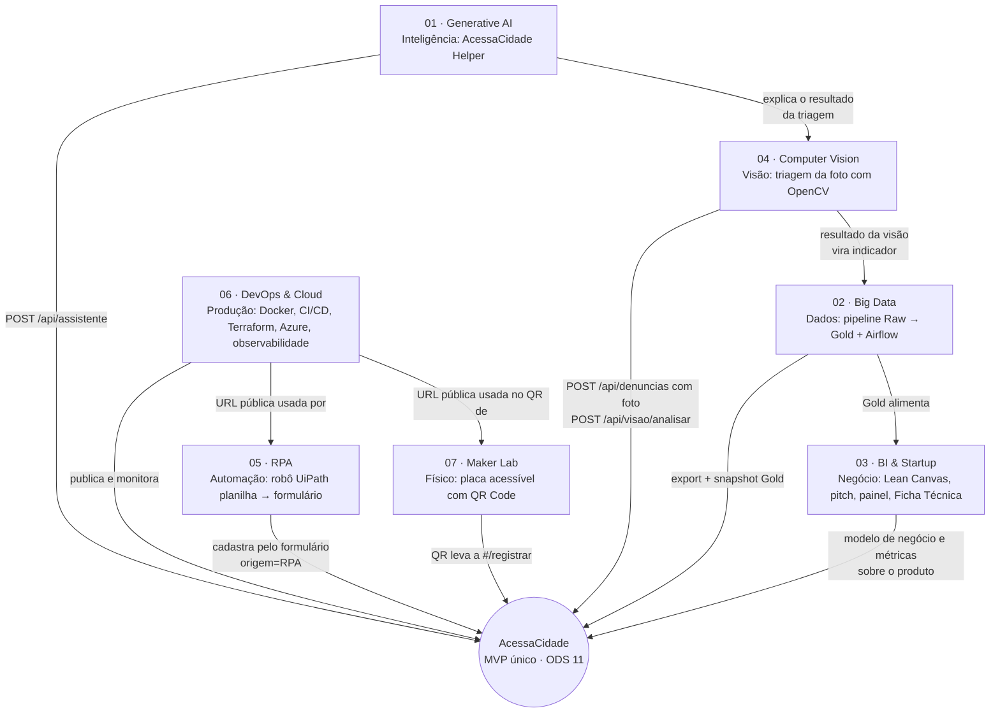

# AcessaCidade — Diagramas de integração

> Como os componentes das 7 disciplinas formam **um único produto**. Os nomes de rotas, campos e arquivos
> seguem o contrato normativo [`CONTRATOS_DE_INTEGRACAO.md`](CONTRATOS_DE_INTEGRACAO.md). A visão textual
> da arquitetura está em [`ARQUITETURA_GERAL.md`](ARQUITETURA_GERAL.md).
>
> Os diagramas usam **Mermaid** (o GitHub desenha automaticamente). Os 5 blocos deste arquivo foram
> conferidos em 15/11/2026 renderizando-os com Mermaid 10.9.1 no Microsoft Edge (sem erro de sintaxe).
> A seção 6 separa as integrações **testadas de verdade** das que **dependem de ação manual**.

## 1. Arquitetura geral

## 2. Comunicação entre componentes — registro de uma denúncia com foto

## 3. Fluxo de dados — da aplicação ao painel analítico

## 4. Fluxo do cidadão

## 5. Relação entre as 7 disciplinas

## 6. Integrações: o que é funcional e testado × o que depende de ação manual

Resultados reais da verificação de 15/11/2026 (máquina local, Windows 11): `python -m pytest` na raiz
→ **492 passed** (reconferido na auditoria); teste ponta a ponta `app/frontend/tests_e2e/e2e_acessacidade.py` (Playwright + Edge)
contra o backend real → **201/201 verificações OK** na auditoria (199/199 na execução que gerou as capturas em [`evidencias/mvp_local/`](../evidencias/mvp_local/LEIAME.md)).

| # | Integração | Contrato | Situação | Como foi verificado / o que falta |
|---|---|---|---|---|
| 1 | Frontend SPA ↔ Backend (todas as telas) | §4, §7 | **Funcional e testada** | E2E 199/199 (início, registrar, detalhe, consultar, análise, assistente, painel, revisão, sobre, 404; 1280 px e 390 px; sem erro de console/CSP) + `app/backend/tests/test_api_*.py` |
| 2 | Backend → Visão: registro com foto | §4.2, §5 | **Funcional e testada** | `test_api_denuncias.py::test_criar_com_foto_sintetica`; E2E; smoke real com uvicorn: `POST /api/denuncias` com foto sintética → 201, `AGUARDANDO_REVISAO`, 7 imagens servidas. Só com imagens **sintéticas** (fotos reais: ação manual, disciplina 04) |
| 3 | Backend → Visão: análise avulsa | §4.5 | **Funcional e testada** | `test_api_pipeline.py::test_visao_analisar_nao_persiste` e `::test_visao_analisar_rejeita_nao_imagem_e_ausencia`; E2E (`#/analise`) |
| 4 | Backend → Helper (modo alternativo por regras) | §4.9, §6 | **Funcional e testada** | `test_api_assistente.py` (fallback, protocolo existente, protocolo inexistente não inventado, rate limit) + `01-Generative-AI-Engineering/tests/`; E2E (`fonte: fallback`) |
| 5 | Helper → LLM real (OpenRouter) | §6 | **Depende de ação manual** | Cliente testado com respostas simuladas (`test_helper_llm_client.py`); chamada real exige `OPENROUTER_API_KEY` da equipe — ver `01-Generative-AI-Engineering/PENDENCIAS_E_ACOES_MANUAIS.txt` |
| 6 | Pipeline → Backend: exportação e publicação Gold | §4.7, §4.8 | **Funcional e testada** | `test_api_pipeline.py::test_export_csv_e_json_sem_nome`, `::test_gold_publicar_e_consultar`; `02-.../tests/test_pipeline_api.py` (API simulada); execução real do pipeline contra a API local na sessão do E2E, com a Gold exibida no painel (`09b_painel_analitico_desktop.png`) |
| 7 | Pipeline local sem API (`--sem-api`) | — | **Funcional e testada** | RAW 271 → BRONZE 260 → SILVER 250; 10/10 checagens de qualidade OK; notebook executado com nbclient |
| 8 | Airflow → Pipeline (DAG) | — | **Depende de ação manual** | Estrutura da DAG testada com stub (`test_pipeline_dag.py`); Airflow real exige Docker/WSL2 — ver `02-Big-Data-Architecture/PENDENCIAS_E_ACOES_MANUAIS.txt` |
| 9 | Gold → Excel/Power BI (03) | — | **Implementada, mas não testada** | Script `03-Business-Intelligence-Startup/dashboard/exportar_gold_para_excel.py`; a pasta 03 não tem testes automatizados |
| 10 | Robô UiPath → Formulário web | §7 | **Depende de ação manual** | Estrutura do XAML e uso dos `id` do contrato verificados estaticamente (`test_rpa_artefatos.py`); o caminho do robô (`#/registrar?canal=rpa` → `origem=RPA`) foi exercitado pelo E2E com navegador, **não** pelo UiPath. Execução no UiPath Studio: manual |
| 11 | Prometheus ← `/metrics` | §10 | **Parcial** | Nomes das métricas e rota templated testados (`test_api_basico.py::test_metricas_nomes_e_rota_templated`); configuração de Prometheus/Grafana/alertas validada estaticamente (`test_devops_observabilidade.py`). Subir a stack e disparar o alerta: manual (Docker) |
| 12 | Docker / Docker Compose | — | **Depende de ação manual** | Dockerfile verificado estaticamente (`test_devops_container.py`) e por Trivy config (0 achados). `docker build`/`compose up` não executados (sem Docker na máquina) |
| 13 | GitHub Actions (CI/CD DevSecOps) | — | **Depende de ação manual** | Ferramentas rodadas localmente com os mesmos alvos: Gitleaks (no leaks found), Semgrep (0 achados), Trivy fs (0 HIGH/CRITICAL), Terraform validate/test. O workflow só roda depois do push no GitHub |
| 14 | Terraform → Azure (ACR + ACI) | — | **Depende de ação manual** | `terraform fmt`, `validate` (Success) e `terraform test` (3 passed, provider simulado). `apply` exige assinatura Azure — ver `06-Secure-DevOps-Cloud/docs/PUBLICACAO_AZURE.md` |
| 15 | Placa (QR Code) → `#/registrar` | §7 | **Depende de ação manual** | Gerador `07-.../laser-cut/gerar_qrcode.py` pronto; o QR definitivo só pode ser gerado com a URL pública real (não foi inventada). Fabricação: manual |

Legenda: **Funcional e testada** = executada nesta máquina com resultado real registrado;
**Implementada, mas não testada** = código pronto sem teste automatizado; **Parcial** = parte testada,
parte manual; **Depende de ação manual** = exige ferramenta, conta ou credencial que não existia no ambiente.
