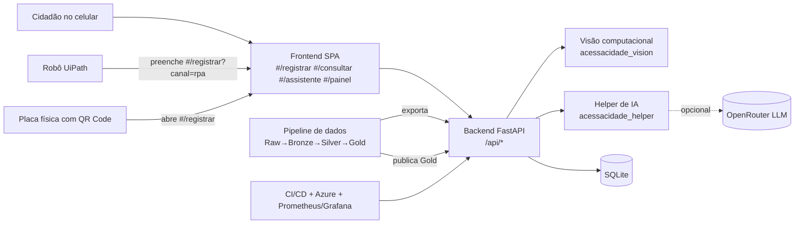

# Ficha Técnica do MVP — AcessaCidade

> Base comum da equipe (PDF oficial da GS 2026.2, pág. 20). Abre o README do repositório e a
> documentação de cada disciplina: todos os professores avaliam o **mesmo produto**, com a mesma lógica.
> Campos marcados com [PREENCHER] dependem de informações da equipe ou da publicação do MVP.

| Campo | Resposta |
|---|---|
| **Nome do produto** | AcessaCidade |
| **Equipe** | [PREENCHER: nome da equipe] — [PREENCHER: nomes e RMs dos integrantes] |
| **Cidadão beneficiado** | Pessoas com deficiência (cadeirantes, pessoas cegas ou com baixa visão), pessoas idosas e pessoas com mobilidade reduzida que se deslocam a pé — e quem as acompanha (familiares, cuidadores) |
| **Território de atuação** | [PREENCHER: cidade/bairros onde a equipe observou o problema]. Os dados de demonstração usam a cidade fictícia **"Cidade Exemplo"** e são sempre identificados como simulados |
| **Problema, em uma frase** | Barreiras nas calçadas (buracos, pisos quebrados, rampas irregulares, obstáculos) impedem ou tornam arriscado o deslocamento dessas pessoas, e não há um jeito simples de avisar quem pode resolver nem de acompanhar o que acontece depois |
| **Proposta de valor** | Para o cidadão: registrar uma barreira em poucos minutos, pelo celular, sem instalar app e sem cadastro, e acompanhar pelo protocolo. Para quem resolve (prefeituras, concessionárias, administradoras de grandes áreas): denúncias padronizadas, com foto triada e explicada, priorizáveis por impacto e visíveis em painel |
| **URL do MVP** | [PREENCHER: URL pública do MVP] |
| **Repositório** | [PREENCHER: URL do repositório público no GitHub] |
| **Vídeo-pitch** | [PREENCHER: link do vídeo] |

## 1. Arquitetura: componentes

Um único sistema web (SPA servida pelo backend) integra os sete componentes por contratos claros
(APIs REST, arquivos e pacotes Python) — detalhes em [`docs/CONTRATOS_DE_INTEGRACAO.md`](CONTRATOS_DE_INTEGRACAO.md).

| Disciplina | Componente no MVP | Componente técnico | Onde está no repositório |
|---|---|---|---|
| Generative AI for Engineering | Inteligência | AcessaCidade Helper: assistente em linguagem simples (registrar, status, explicar a triagem, ajudar a escrever a descrição), LLM via OpenRouter + modo alternativo por regras + guardrails | `01-Generative-AI-Engineering/` (pacote `acessacidade_helper`, `POST /api/assistente`, tela `#/assistente`) |
| Big Data Architecture & Data Integration | Dados | Pipeline ELT Raw → Bronze → Silver → Gold em DuckDB + Pandas, orquestrado por Airflow (com runner local), publica indicadores analíticos | `02-Big-Data-Architecture/` (`GET /api/indicadores/analiticos`, `data/processed/gold/`) |
| Business Intelligence & Startup Development | Negócio e pitch | Lean Canvas, modelo de negócio, métricas e impacto, pitch; dashboard do MVP (`#/painel`) e exportação da Gold para Excel/Power BI | `03-Business-Intelligence-Startup/` |
| Applied Computer Vision | Visão | Triagem automática da foto com OpenCV clássico (7 etapas visíveis, medidas, regra explicável, privacidade: sem EXIF/GPS, rostos borrados) | `04-Applied-Computer-Vision/` (pacote `acessacidade_vision`, `POST /api/visao/analisar`, tela `#/analise`) |
| Robotic Process Automation | Automação | Robô UiPath que cadastra no AcessaCidade as denúncias recebidas em planilhas (associações, ONGs) e devolve o protocolo linha a linha | `05-Robotic-Process-Automation/` |
| Secure DevOps Tools & Cloud Computing | Produção | Docker, CI/CD DevSecOps no GitHub Actions (testes, varredura de segredos e vulnerabilidades), Terraform na Azure (ACR + ACI), Prometheus + Grafana | `06-Secure-DevOps-Cloud/`, `.github/workflows/`, `docker-compose.yml` |
| Project-Based Maker Lab | Físico | Placa de sinalização acessível (alto contraste, relevo, Braille) com QR Code que leva ao registro (`#/registrar`) | `07-Project-Based-Maker-Lab/` |
| (base comum) | Produto | Frontend SPA acessível (HTML/CSS/JS puro) + backend FastAPI + SQLite | `app/frontend/`, `app/backend/` |

## 2. Fontes de dados

| Fonte | Descrição | Natureza |
|---|---|---|
| Denúncias dos cidadãos | Formulário `#/registrar`: endereço do problema, tipo, impacto, descrição, foto opcional, consentimento; nome opcional (nunca exposto nem exportado) | Real, quando o MVP estiver em uso |
| Fotografias | Enviadas com a denúncia; validadas, sanitizadas (sem EXIF/GPS, rostos borrados) e triadas | Real, quando enviadas |
| Planilhas de parceiros (RPA) | Denúncias recebidas fora do site, cadastradas pelo robô com `origem=RPA` | Simuladas na demonstração |
| Base de demonstração | Seed da aplicação e fonte "bagunçada" do pipeline (`data/samples/denuncias_simuladas.csv`), sempre com `simulado=true` / `origem_dado=SIMULADO` | **Simulada** (Cidade Exemplo) |
| Imagens de teste da visão | `data/samples/fotos/` — geradas por computador | **Sintéticas** |
| Camada Gold | Indicadores agregados por bairro, categoria, período, status e resultado da triagem (`data/processed/gold/`) | Derivada (inclui simulados, sinalizado) |
| Dados públicos de contexto | Ex.: população com deficiência (IBGE) — [PREENCHER: dado + fonte, conferidos antes do pitch] | Pública, com fonte citada |

## 3. Modelos de IA utilizados

| Modelo | Uso | Observações |
|---|---|---|
| Visão computacional **clássica** com OpenCV + NumPy (sem rede neural) | Triagem da foto: possível buraco / nenhum indício / inconclusiva | Explicável (cada decisão cita as medidas); pontuação heurística 0–1 que **não é probabilidade**; revisão humana obrigatória; avaliada só em base **sintética** até agora |
| LLM via **OpenRouter** (API compatível com OpenAI), modelo configurável — padrão `openai/gpt-4o-mini` | Assistente AcessaCidade Helper | `temperature` 0,2; contexto fechado; guardrails de entrada e saída; nome do denunciante nunca enviado |
| **Modo alternativo por regras** (sem IA generativa) | Respostas do assistente sem chave ou com falha da API | Garante funcionamento mesmo sem o serviço externo |

## 4. Indicadores de impacto (definições — sem valores reais inventados)

| Indicador | Definição / fórmula | Fonte | Resultado |
|---|---|---|---|
| Tempo para registrar um problema | Tempo (s) da página inicial ao protocolo no AcessaCidade × tempo no canal atual, mesma pessoa e mesmo problema | Teste de usabilidade cronometrado | [PREENCHER: medido pela equipe] |
| Conclusão sem ajuda | % de participantes que concluem o registro sem ajuda | Teste de usabilidade | [PREENCHER] |
| Facilidade percebida (SUS) | Pontuação SUS 0–100 | Questionário pós-teste | [PREENCHER] |
| Barreiras registradas por bairro | Nº de denúncias por bairro e por categoria | `#/painel` / Gold | Na demonstração os números incluem dados **simulados** e não são impacto |
| % de denúncias com foto analisada | (total − sem_imagem) ÷ total | `GET /api/indicadores` (`#/painel`) | Idem |
| % de triagens revisadas por humano | Denúncias com `revisao_humana` preenchida ÷ denúncias com foto | Exportação `GET /api/export/denuncias` (cálculo do pipeline/manual; não está no painel no contrato atual) | Idem |
| Tempo até encaminhamento | Mediana entre o registro e o status "Encaminhada" | Histórico de status (piloto real, futuro) | [PREENCHER: quando houver piloto] |

Definições completas: `03-Business-Intelligence-Startup/business-model/METRICAS_E_IMPACTO.md` e
`03-Business-Intelligence-Startup/dashboard/README.md`.

## 5. ODS conectados

| ODS | Meta | Como o AcessaCidade contribui |
|---|---|---|
| **ODS 11 — Cidades e comunidades sustentáveis** (principal) | 11.7 — acesso universal a espaços públicos seguros, inclusivos e acessíveis, em particular para idosos e pessoas com deficiência | Torna visíveis as barreiras nas calçadas, com registro, triagem, acompanhamento e painel por bairro |
| | 11.2 — transporte seguro e acessível, com atenção a pessoas com deficiência e idosos | Barreiras no caminho a pé até pontos de transporte (placa com QR Code no ponto de ônibus) |
| | 11.3 — urbanização inclusiva e planejamento participativo | Denúncias como participação cidadã; dados agregados para planejamento |
| **ODS 10 — Redução das desigualdades** (secundário) | 10.2 — inclusão social independentemente de deficiência ou idade | Interface acessível e linguagem simples; quem mais sofre com as barreiras ganha voz e acompanhamento |
| **ODS 9 — Indústria, inovação e infraestrutura** (secundário) | 9.1 — infraestrutura de qualidade, confiável e acessível para todos | Dados por categoria de infraestrutura (calçada, rampa, piso tátil) para priorizar manutenção |

## 6. Limites declarados

- O AcessaCidade **não é serviço oficial do governo**; o status "Resolvida" é registro da equipe, não confirmação de órgão público.
- A triagem por imagem é **apoio**, nunca decisão: toda foto passa por revisão humana.
- Nenhuma parceria ou contrato com órgão público existe hoje; valores de preço são **hipóteses a validar**.
